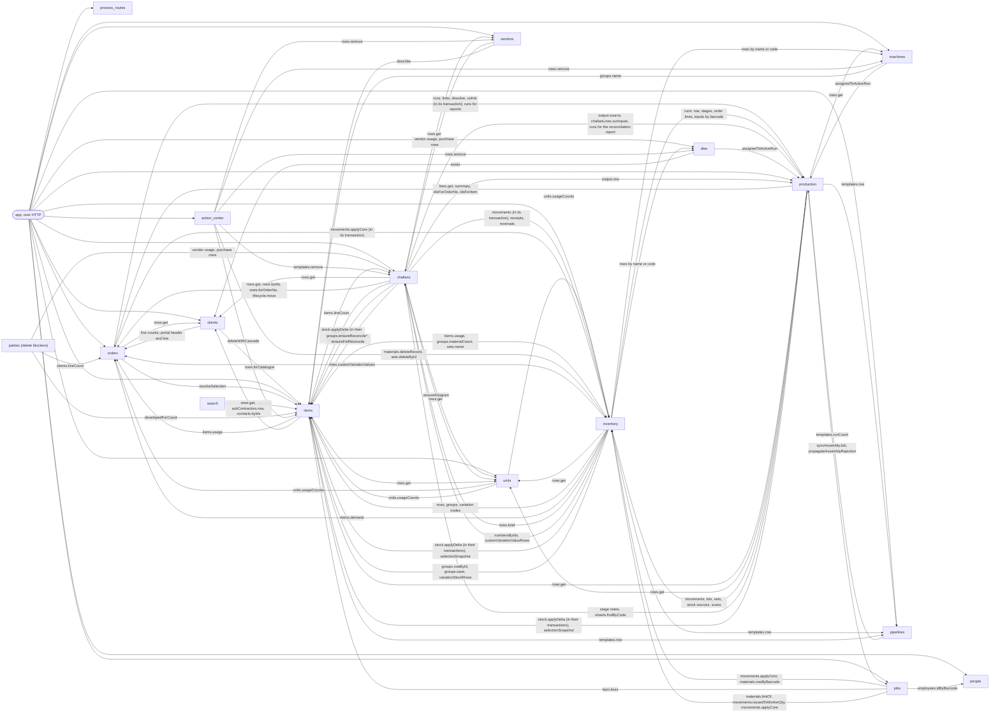

# 12 · Modules as services — plan, checklist, progress and bugs

This is the working record of turning Paper's modules into separate services.
It is edited with every change, so the plan, what is done, how the work went and
what was found along the way are all here and nowhere else. If a conversation is
lost, start from this file.

Last updated: 2026-11-19 (P8 done, in part: 349 of 423 schema statements live in the modules; the rest wait on the rebuilds).

## 1. The plan

### Why

Paper has to be sellable in parts. One client takes only Orders, another only
Production, another a combination. So every module (orders, production,
inventory, challans, each master) becomes its own service, with its own API,
behind its own wall.

### The kingdom, in Paper's terms

| Kingdom | In Paper |
|---|---|
| Kingdom | One client's deployment |
| Neighbourhood | A module running as its own service |
| Wall | The service answers nothing that does not come through its gate |
| Gate | The service's API: one named operation per thing it can do |
| Pass | A signed token saying which service is calling, for which operation, for which user |
| City gate | One gateway, the only door the app and the outside can reach |
| Messenger | The kernel desk (`backend/kernel/desk.js`), which carries a call from one module to another |

### The ladder

| Level | Meaning | State |
|---|---|---|
| Function | A module's work, callable by name with no request | Built for process routes and orders |
| Feature | Function + API + screen inside Paper | What the app is today |
| System | A chosen set of modules deployed alone for a client | Stage 3 |

### Order of work, and why

A wall around a module is only real if the module has a contract for everything
it is asked, and does not share its tables. Neither is true yet. Splitting into
separate processes first would only move the tangle onto the network. So:

1. **Stage 0** — remove the terminal program (not wanted now).
2. **Stage 1** — API contracts for every module.
3. **Stage 2** — database decoupling, still in one database file.
4. **Stage 3** — the walls: gates, passes, a service map per client, modules as
   separate processes, a gateway, and last a database per service. Not yet
   planned in detail and not yet approved.

### Decisions taken

| Date | Decision |
|---|---|
| 2026-11-17 | Go to the function level first, then system. |
| 2026-11-18 | Contracts and database decoupling come before gates, passes and separate processes. |
| 2026-11-18 | One database file until stage 2 is finished; a database per service only after. |
| 2026-11-18 | The terminal program (`bin/paper.js`) is removed. The desk stays. |
| 2026-11-18 | Calls between modules stay inside one process until stage 3, so operations that share a transaction (challan issue, order delete) keep working. |
| 2026-11-18 | Contracts are enforced for every operation. `PAPER_CONTRACTS_MODE=report` turns enforcement off on a running installation without a code change. |
| 2026-11-18 | A contract says what a field is and what is plainly required; it does not repeat a master's own rules, which keep answering in their own words. |

### Decisions taken on 2026-11-19

- The rest of the sandbox control plane goes: `/sandbox-config`, `/api/sandbox-sync`,
  `/api/session-replay`, `/api/activation/*`, and the update feed that read the
  sandbox config. The desktop app stops calling them and loses its activation gate.
  socket.io stays (the mobile app depends on it) but requires the login token.
- The freelancer portal keeps requiring a login; the card link is a shortcut for a
  signed-in worker, not a credential on its own.
- Contracts: every field typed, including the fields of bodies handed whole to a
  service; required only where the code already refuses.
- `main` is fast-forwarded to this work and pushed, which deploys staging.

### Waiting for a decision

- Stage 3 itself: which modules a real client needs split, and whether any
  module ever needs its own machine.

### Staging watch list

After the deploy of 2026-11-19, with the app in real use:

- `GET /api/kernel/guard-alerts`: any entry whose route reads
  `operation <name> (input, enforce)` is a request the app made that a contract
  refused. Each is either a contract to loosen (and the evidence run to repeat) or
  a client bug; decide per case and record it here. `PAPER_CONTRACTS_MODE=report`
  turns enforcement off without a code change if the app is blocked.
- Job cards printed before the deploy no longer open the freelancer portal and must
  be reprinted.
- The server log on first start says `Hashed N portal password(s) that were stored
  as plain text.` once, and never again.
- The deploy of `main` (8577592) failed the same way the previous one did:
  `appleboy/scp-action` says "can't connect without a private SSH key or
  password", so the workflow's SSH secret for the staging host is missing or
  empty. Nothing of this work has reached staging; the watch list above waits
  on that secret being set and the workflow re-run.

### Stage 1 — API contracts for every module

**1a. Make contracts mean something.** In the desk: output contracts; two
strictness modes per operation (`report` records a violation and carries on,
`enforce` refuses it); a contract catalogue with a snapshot test so any contract
change is a visible diff.

**1b. Convert the 13 remaining modules.** One module per commit:

1. `modules/<name>/operations.js`: operations offered to users, and everything
   other modules ask of it as internal operations.
2. Its routes ask the desk. HTTP answers must not change.
3. Every module that was handed its ports or helpers asks the desk instead, and
   declares the name in its `uses` list.
4. Typed input and output contracts, starting in `report` mode.

Order: units → vendors, clients, people, machines, dies, pipelines → production
→ inventory → challans → items → jobs, action center.

Done when `server.js` hands nothing from one module to another.

### Stage 2 — database decoupling (one file)

**2a. Measure it and stop it growing.** Finish table ownership in
`kernel/registry.js`. A test scans every module's SQL for tables owned by another
module; today's violations go in a list that may only shrink.

**2b. Burn the list down.** Each read of another module's table becomes a call to
the owner. Reports that join several modules keep their SQL but declare each
foreign table in a `reads` list.

**2c. Writes across modules.** A module never writes another's table; it asks the
owner. Operations that must run in the caller's transaction are marked, which
later tells stage 3 which modules cannot be split apart. Cascades across module
lines become explicit calls.

**2d. Each module creates its own tables** in `modules/<name>/schema.js`, moved
out of `initDb` in `server.js`.

Done when the violation list holds only declared `reads`, no module writes a
table it does not own, and `initDb` holds no business table.

### First build (done 2026-11-18)

Stage 0, stage 1a, stage 2a, and units taken through 1b and its share of 2b. That
gives the two measuring instruments and one module done to the full standard, so
the remaining twelve are a known amount of work.

### Next

Stage 1b is done for all 15 modules: every one publishes its operations, its
routes ask the desk, and no module is handed another's ports. What is left:

The packages, in order (approved 2026-11-19; P0 is done):

| # | Package | State |
|---|---|---|
| P0 | Merge to main and push; `encrypt` package dropped; this doc's dates fixed; staging watch list | done |
| P1 | Remove the rest of the sandbox control plane (server and desktop app); socket.io removed outright, since no client connected to it | done |
| P2 | Tests remove their temporary databases (B24) | done |
| P3 | Typed contracts for every operation, per module, each with an evidence run | done |
| P4 | Orders' 11 and process routes' 2 undeclared reads become asks or declared reads | done |
| P5 | Items logic out of `server.js` into `modules/items` (2,700 lines, one move by function name) | done |
| P6 | Kernel-side crossings: 17 kernel-service touches of module tables, 8 module touches of kernel tables | done |
| P7 | Writes across modules get transactions (stage 2c); cascades deferred | done |
| P8 | Each module creates its own tables (stage 2d), behind a schema snapshot test | done (the last 74 statements with B37) |

Not in these packages: stage 3 (walls), an event bus, and replacing cross-module
`ON DELETE CASCADE` with explicit calls.

Still open: the staging check, because the deploy cannot reach the host (B38).

Next, approved 2026-11-19: stage 2e, the wire — nine steps in the checklist below, step 1 done.

### Left as they are, on purpose

| Routes | Why they call something other than an operation |
|---|---|
| Machine and die photos (6) | They call the kernel's asset service, which is not another module |
| Order PO documents (5) | Mostly S3 presigning; to do with the rest of orders |

### How to convert a module (the recipe units followed)

1. Move any of its logic still in `server.js` into the module; leave one-line
   function declarations behind for seeds and tests that call the old names.
2. Write `modules/<name>/operations.js`: user operations with the permission
   the HTTP gate already asks for, internal operations for what neighbours ask.
3. Make the routes ask the desk. They receive `desk`, never the database.
4. Replace every read of another module's table with an internal operation on
   the owner, and declare it under the caller's `uses` in `server.js`.
5. Typed input and output contracts, in `report` mode.
6. Run the suite, then record the two snapshots:
   `UPDATE_CONTRACT_SNAPSHOT=1` and `UPDATE_BORDER_SNAPSHOT=1` (the second
   refuses a list that grew).
7. Update this file and the mind map.

Traps met so far:

- An operation's permission must be the key the central gate asks for on that
  path, or users with unusual grants get a different answer. The gate treats
  every POST as `create`; a POST that only reads needs an exception in
  `moduleOpForRequest`.
- A path whose first segment maps to no module is not gated by module at all.
  Declare the segment (as `unit-groups` was) before giving its operations a
  permission.
- Keep input contracts loose or in `report` mode where the service already
  validates, or an HTTP answer changes.
- Internal operations must let the service's errors throw; their callers run
  inside their own transactions and want the original error.
- A body that carries its own `id` (a machine or die upsert, a pipeline
  template) must not be spread next to the path's id. Pass it whole, or under
  `data`.
- Some routes answer a refusal with extra keys (`client: null`, `code: null`)
  and some with the error alone. Keep each route's own failure body; do not
  send one generic refusal for all.
- A route that was never behind a module permission needs an operation that
  asks what its own guard asked, not a new permission. The desk has three
  rules for that besides `permission`: `access: 'signedIn'` (any signed-in
  user), `access: { anyRole, anyPermission }` (a role in the list or any one
  key; this is how the old write gate is expressed), and `roles: [...]` on top
  of either (an employee's login is admins only).
- Read a guard's code before trusting a comment about it. The portal routes'
  own header said they were open to any signed-in session; the old write gate
  in front of them lets only an admin, `config.write` or `inventory.update`
  make a POST.
- When a module's logic lives inside its HTTP handlers (production had about
  900 lines there), move it mechanically: each handler becomes a function of
  a plain `req` that returns `answer(status, body)` instead of sending. Then
  check every site: a nested helper that used to send and whose caller then
  did a bare `return` now returns nothing. Production had one.
- A read that cannot be split without changing a filtered, paged query is
  declared, not hidden: `reads: { table: 'why' }` in the module's manifest in
  `kernel/registry.js`. The meter marks it "(declared)" and counts it apart.
- Each full test run leaves about 800 throwaway database folders (about
  1.2 GB) in the system temp folder; nothing removes them (bug B24). Clear
  `paper-*` there after a run, or the disk fills in a day of work.
- Two operations in one module must not share a name. A module's operations
  are one object, so the later key silently replaces the earlier: production
  asking inventory to apply a movement was answered by the user's operation of
  the same name. Build internal and user operations separately and refuse a
  clash (see `modules/inventory/operations.js`).
- When a module is handed a client in place of ports, every function on it is
  asynchronous. A port that was a plain function and was called without
  `await` (inventory's `sources.propose`) then yields a promise. Search the
  callers for port calls that are not awaited.
- A module with many callers written against its ports can keep them
  unchanged: list what it offers once (`modules/inventory/asks.js`), build the
  internal operations and a client of the same shape from that list
  (`client.js`), and hand each caller the client made from its own desk
  handle. Track entries a moved handler wrote ride on the result as `track`
  and are written by the route (`deskRoutes` in `kernel/desk-kit.js`).
- A handler that sends its answer and then does more work (challan issue and
  cancel broadcast a stock change after answering) cannot simply `return` the
  answer: the work after it would be skipped. Decide the answer, do the rest
  in a way that cannot change it, then return it. The move script reports
  every site with code after an answer; never ignore that line.
- Names a route file imported at the top (`barcodes`) do not move with the
  handler bodies. Carry the imports to the work file.
- Keep routes in their original order when regenerating a route file: Express
  matches the first registration, and `/scans` before `/:id` is not a detail.
- A handler that sends a file answers with `answerFile`; the result carries
  `file` and `deskRoutes` sends it.
- `operationsFromAsks`, `clientFromAsks` and `joinOperations` in
  `kernel/desk-kit.js` are the shared form of inventory's asks and client. A
  port that returns a Map says `returns: 'map'`; it crosses as pairs.
- A guard like `if (trackCreate) trackCreate(...)` leaves `if (trackCreate)`
  behind when the call becomes `req.track(...)`, and the name no longer exists.
  After a move, scan the file for names that are used and never declared; a
  parser-based check (acorn is in `node_modules`) found none across every
  moved file, and should be re-run after each move.
- A read that joined several modules' tables can be checked exactly: keep the
  old statement in the test, run it beside the new read, and require the same
  answer (`items-operations.test.js`, `units-operations.test.js`).
- Do not keep a neighbour's answer in a module-level cache. A unit's name
  looked up once and remembered would stay after the unit is renamed.
- A handler written across several lines (`return res\n.status(400)\n.json(`)
  is not matched by the move script; the script's count of answers against
  `.json(` calls shows it (78 of 79).
- Before enforcing, gather evidence: run the suite with
  `PAPER_CONTRACT_VIOLATIONS_FILE=<file>` in report mode and read what was
  violated. Then enforce and run it again; a test that fails shows an answer
  that changed.
- Enforcing must not add business rules. Two contract rules were stricter than
  the code behind them (a unit's conversion factor "above zero", which the
  master only requires for a unit in a family; "a client needs a name", which
  the service already says in better words) and were loosened.
- Under enforce an internal call with a missing argument throws at the caller.
  List arguments the ports treat as optional are optional in the contract too.
- A contract says what a field is; it must not speak before a service that
  already answers a shape in its own words. Two found by the evidence run:
  route steps (a list of ids or of objects; the validator says
  `route_steps_malformed`) and unit conversions (each line answers for
  itself). Those fields stay untyped, listed in the test as exceptions.
- Query values are strings: a flag written `?withCovers=1` is text, not a
  boolean, because the checker's boolean takes only true, false, 0, 1,
  'true' and 'false'.
- Ids from the path are integers above zero where the table's id is an
  integer, and non-empty strings where it is text (pipeline templates,
  production runs, barcodes). A non-numeric id is now refused with 400
  "id must be a number" where it used to be looked up and answered "not
  found".
- Move functions by NAME, not by line number: the first cut shifts every
  line below it. The items move cut 49 functions by matching
  `^(async )?function NAME(` and the closing `}` at column 0.
- Insert the replacement wiring at a stable anchor (a named line), not at the
  position of the first cut; the first attempt landed inside another
  function's body and `node --check` did not mind.
- A factory per file taking `(deps, api)`, with every cross-file call
  written as `const sibling = (...a) => api.sibling(...a)`, lets the moved
  bodies stay verbatim while the files reach each other at call time.
- A client built from an `asks.js` list only has what the list names: a
  function added to a module's ports is not on the client until it is in the
  list. Calling a missing one is a TypeError, and inside a seed it left a
  transaction open and the suite hanging.
- Code that moves into a module folder becomes visible to the border meter.
  The items move exposed eleven foreign reads that had always been there.
- A kernel folder (accounts, assets, links, search, settings) registers at the
  desk like a module: it publishes what modules need of its tables and
  declares what it asks of them. The border meter treats it as `kernel`, so
  its own tables are never a crossing, and after P6 nothing else is either.
- A moved handler answers a failure (`{ status: 500 }`) instead of throwing,
  and a service answers `{ refusal }`; a savepoint around such a body must
  roll back on those answers too, not only on a throw. `withSavepoint` and
  `withTransaction` take `rollbackWhen`, and the default knows both shapes.
- A flow wrapped in a savepoint must not call anything that opens its own
  `BEGIN`: `movements.apply` inside production became `applyCore` with
  `useTransaction: false`. SQLite refuses a nested BEGIN; a savepoint nests.
- `desk.trip(name, error)` makes the next call of an operation fail before
  it runs. It exists for tests of what a failure mid-flow leaves behind, and
  for nothing else.
- A schema split needs an oracle before the first cut: `schema-snapshot.test.js`
  pins `sqlite_master` on two ways in. Its first run after the split caught the
  module schemas running BEFORE `initDb` dropped the legacy tables that
  referenced the old `orders` table (so the end-of-boot migration runner
  recreated them in their old shape); the fix was where the schema phase
  runs, not what it holds.
- Move only a plain statement (`await run(CREATE …)`, `await
  ensureColumnExists(…)`, a one-line `try { ALTER TABLE … ADD COLUMN }`).
  A table that a rebuild in `initDb` reshapes keeps its statements there,
  with that rebuild; moving its indexes ahead of the rebuild would lose them.
- The names-used-but-never-declared scan is per file, not per scope. A name
  declared as one function's parameter hides its absence in another function
  of the same file (`desk` in production's `internalOperations`, 2026-11-19).
  Run the full suite to completion before committing, every time.
- `kernel/desk-kit.js` has the shared pieces: `refusing` (a thrown 4xx becomes
  a result), `fromRefusal` (a service's `{ refusal }` becomes a result) and
  `httpKit` (`ask` and `refuse` for a route file).

## 2. Checklist

Ticked only when a test proves it.

### Before the re-plan (function level)

- [x] Kernel desk: operations by name, one result shape, actor checks (`kernel/desk.js`, `kernel-desk.test.js`)
- [x] Process routes publish operations; routes ask the desk
- [x] Orders publish operations; the six line routes ask the desk
- [x] Order edit and delete moved out of their HTTP handlers (`modules/orders/line-writes.js`)
- [x] Every caller of the orders ports asks the desk and has declared what it asks
- [x] Calls per operation shown by `/api/kernel/territory`

### Stage 0 — terminal program

- [x] `bin/paper.js`, the `paper` npm script and the `paper` tests removed
- [x] Desk actor `terminal` renamed `system`

### Stage 1a — contracts that mean something

- [x] Output contracts checked by the desk (`kernel-desk.test.js`)
- [x] `report` and `enforce` modes per operation
- [x] Violations visible at `/api/kernel/guard-alerts` (`units-operations.test.js`)
- [x] Contract catalogue (`desk.catalogue()`)
- [x] Snapshot test `contract-surface.test.js` (343 operations: 222 for users, 121 internal; 14 must run inside the caller's transaction)
- [x] Access rules besides a permission: any signed-in user, role or key, role on top (`kernel-desk.test.js`)
- [x] Evidence run: the journey and the whole suite in report mode recorded 9 violations in 7 operations, every one a test sending a missing or empty name on purpose; none on any result
- [x] Contracts enforced for all 343 operations (`defaultMode: 'enforce'` in `server.js`; `units-operations.test.js` asserts every operation's mode)
- [x] The Flutter app's request models for units, vendors, clients, contacts, sub-contractors and die makers checked against the contracts by reading them (text fields are strings, the conversion factor a number)
- [x] Operator switch `PAPER_CONTRACTS_MODE=report`, and `PAPER_CONTRACT_VIOLATIONS_FILE` to collect violations across a test run
- [ ] The same evidence from a real installation: watch `/api/kernel/guard-alerts` on staging with the app in use
- [x] Every field of every user operation typed (`kernel/fields.js` is the vocabulary; `contract-surface.test.js` refuses a new untyped field and lists the eleven kept untyped on purpose)

### Stage 2a — the border meter

- [x] Every table has an owner in `kernel/registry.js` (`TABLE_OWNERS`; 29 tables were unowned)
- [x] `module-borders.test.js` with its starting list of crossings
- [x] Starting count recorded here: **93** crossings

| Crossings (a module's code naming a table it does not own) | Start | Units | Small masters | Production | Inventory | Challans | Items | Jobs, action centre | P1 | P4 | P5 | P6 |
|---|---|---|---|---|---|---|---|---|---|---|---|---|
| A module reads another module's table, undeclared | 63 | 57 | 54 | 50 | 42 | 36 | 25 | 13 | 13 | 0 | 0 | **0** |
| A module reads another module's table, declared with a reason | 0 | 0 | 0 | 1 | 1 | 3 | 4 | 13 | 13 | 15 | 26 | 26 |
| A module writes another module's table | 0 | 0 | 0 | 0 | 0 | 0 | 0 | 0 | 0 | 0 | 0 | **0** |
| A module touches a kernel table (links, assets, users…) | 8 | 8 | 8 | 8 | 8 | 8 | 8 | 8 | 8 | 8 | 8 | **0** |
| A kernel service (search, accounts, settings…) touches a module's table | 22 | 22 | 22 | 22 | 22 | 22 | 22 | 22 | 17 | 17 | 17 | **0** |
| **Total** | **93** | **87** | **84** | **81** | **73** | **69** | **59** | **56** | **51** | **40** | **51** | **26** |

The total rose in P5 because the items logic, moved out of `server.js` (which
the meter never scanned), carries eleven reads of other modules' tables. They
were always there; now they are counted and declared.

Declared reads so far:

- production reads `items`: the finished-output list filters and searches on
  the item inside one limited query;
- challans reads `order_items`: the reconciliation report joins every issued
  challan line to its order line in one statement;
- challans reads `inventory_movements`: the waste audit finds which reception
  an older material came in on;
- items reads `order_items`: a group's overview and its cover pictures rank
  items by how often they are ordered, inside the ranking query;
- the action centre reads nine tables of six modules: its integrity scan
  looks for references to records that are gone (an order naming a deleted
  client, an item in a deleted group), which is a join across modules by
  nature. For stage 3 each owner will have to answer "what of mine points at
  nothing" itself.

- orders reads `delivery_challan_items` and `delivery_challans`: the order list
  sums what was delivered against each line inside its one paged, filtered
  query (and its run status comes from production through a fragment handed
  over as text, which the scanner does not see).

- items reads eleven tables (`delivery_challan_items`,
  `order_material_requirements`, `materials`, `material_group_item_links`,
  `pipeline_templates`, `clients`, `sub_contractors`, `party_contacts`,
  `units`, `machines`, `dies`): the item list and a group's row are one
  statement each with usage counted and the developed-for names joined in,
  and an item's DTO joins its units, machines and dies for every row of a
  list. Asking per row would multiply the calls by the length of the list.
  The single-row reads (a part's unit, machines and dies when saved; the deal's
  client, contractor and people; a group's material; where one item is used)
  became asks.

Every crossing left is a declared read; `module-borders.test.js` asserts that
undeclared module reads, kernel-service touches of module tables and module
touches of kernel tables are all zero. The kernel's own services (accounts,
assets, links) publish operations for their tables; search asks each owner for
its hits; deleting a login account asks the modules that name a user to forget
it, inside the account's transaction. `user_favorite_items` is the kernel's: a
preference of the account.

What the meter cannot see: `server.js` itself, SQL whose table name is built at
run time, and writes done through a function another module handed over (those
are counted by stage 1b's "no hand-offs", not here). That is why "writes" reads
0 while the code survey found many cross-module writes.

### Per module

Columns: **Ops** operations published · **Routes** routes ask the desk ·
**Callers** other modules ask the desk, no hand-off · **In** inputs typed ·
**Out** outputs declared · **Enf** contracts enforced · **Reads** foreign reads
removed or declared · **Writes** no foreign writes · **Schema** owns its tables.

| Module | Ops | Routes | Callers | In | Out | Enf | Reads | Writes | Schema |
|---|---|---|---|---|---|---|---|---|---|
| process_routes | ✅ 6 | ✅ | ✅ (none) | — | — | ✅ (loose) | 2 left | ✅ | — |
| orders | ✅ 23 | part (PO documents direct) | ✅ | — | part | ✅ (loose) | 11 left | ✅ | — |
| units | ✅ 15 | ✅ | ✅ | ✅ | ✅ | ✅ | ✅ 0 left | ✅ | — |
| vendors | ✅ 7 | ✅ | ✅ | ✅ | ✅ | ✅ | ✅ 0 left | ✅ | — |
| clients | ✅ 24 | ✅ (contacts and portal included) | ✅ | part (portal bodies are loose) | ✅ | ✅ | ✅ 0 left | ✅ | — |
| people | ✅ 12 | ✅ (logins included) | ✅ | part | ✅ | ✅ | 0 module, 2 kernel (`users`) | ✅ | — |
| machines | ✅ 4 | ✅ (photos call the kernel) | DTO mapper still handed to order reports | part | ✅ | ✅ | ✅ 0 left | ✅ | — |
| dies | ✅ 9 | ✅ (die makers included; photos call the kernel) | DTO mapper still handed to order reports | part | ✅ | ✅ | ✅ 0 left | ✅ | — |
| pipelines | ✅ 9 | ✅ (both route sets) | DTO mapper still handed to production | part | ✅ | ✅ | ✅ 0 left | ✅ | — |
| production | ✅ 34 (15 for users, 19 internal) | ✅ | ✅ (one SQL fragment still handed to orders) | part (run payloads are free-form) | part | ✅ | ✅ 0 undeclared, 1 declared | writes inventory, items stock, challans and jobs through their ports | — |
| inventory | ✅ 47 (22 for users, 25 internal) | ✅ | ✅ for challans, orders, production, jobs; items and the action centre (code still in `server.js`) call the ports | part (payloads are large; path values are named) | part | ✅ | ✅ 0 module, 1 kernel (`uploaded_assets`) | still handed items' stock and group functions by `server.js` | — |
| challans | ✅ 53 (42 for users, 11 internal) | ✅ (all four route files) | ✅ vendors, production, inventory hold a client | part (payloads are large; path values are named) | part | ✅ | ✅ 0 undeclared, 2 declared, 3 kernel (assets) | still handed items' reconcile helpers and stock functions by `server.js` | — |
| items | ✅ 67 (43 for users, 24 internal) | ✅ (all four route sets) | ✅ every module holds a client; pure tree helpers and DTO mappers are still passed as code | part (an item's payload has its own contract at the route) | part | ✅ | ✅ 0 undeclared, 1 declared, 2 kernel (`entity_links`) | ✅ | — (its logic is still in `server.js`) |
| jobs | ✅ 8 (6 for users, 2 internal) | ✅ | ✅ production holds a client | part | part | ✅ | ✅ 0 left | ✅ | — |
| action_center | ✅ 8 | ✅ | ✅ (deletes are carried out by the owning module) | part | part | ✅ | 9 declared (the integrity scan) | ✅ | — |

"In: part" means the body is free-form or an upsert, so only the fields with a
fixed meaning are typed. "Out: ✅" means every operation that returns data
declares it. The rest of the crossings (26) are in kernel-service folders:
search, accounts, the control plane and settings.

### Stage 2e — the wire (approved 2026-11-19)

The playbook assessed on 2026-11-19 (BFF, GraphQL/gRPC, CQRS read models, event
deltas, edge cache, database per service) came down to: Paper stays a modular
monolith; the cost is the wire, not the server. Nine steps, in this order, one
commit each, the suite green before every commit:

- [x] 1. Assert wire budgets — `test/wire-budget.test.js` on `test/helpers/sized-workspace.js`: sign_in ≤ 20 requests and ≤ 120 KB compressed, orders list ≤ 40 KB, items list ≤ 60 KB, inventory_overview exactly 1 request, replica_hydration ≤ 3 requests. Measured 2026-11-19: sign-in 21 requests / 57.3 KB, orders 7.8 KB, items 26.7 KB, inventory 4 requests, hydration 14 requests / 60.6 KB. The three that are over are pending on steps 3 and 5 and assert they stay over until then.
- [x] 2. Parallelise start-up: inventory's three list reads start together (health follows, since it falls back on the materials), units' two and the action centre's two overlap; a refresh asked for while one runs joins a single follow-up run, so the three socket events of one generated challan cost two reloads, not three. Mobile: the ProxyProvider `update`s no longer refresh (each list was fetched twice), the inventory tab and the shell no longer reload on mount, and the one start-up refresh also covers favourites and challans. Pinned by `apps/challan_mobile/test/startup_requests_test.dart` (each path once) and `packages/core_erp/test/inventory_provider_refresh_test.dart`. Found on the way: B39.
- [x] 3. One `GET /api/inventory/overview` (`inventory.overview`): materials, stock, sets and the tiles in one answer, each part exactly what its own endpoint answers (`inventory-overview.test.js` compares them); ETag'd like `/api/materials`, so an unchanged refresh is a 304; `?materials=0` for a client whose replica holds the materials. A tiles failure is reported as `healthError` and the client estimates, as before. Client: an `InventoryOverviewReader` interface beside `InventoryRepository` (so the fakes and demo store compile unchanged), implemented by the API and local-first repositories; the provider asks once when it can. The phone uses the same repository, so it moved too (planned for step 7). Measured: sign-in 21 → 18 requests, 57.3 → 53.5 KB; inventory 4 → 1 request. The four old endpoints stay. Not done, on purpose: the two N+1s inside stock and sets — in-process SQLite, the whole overview answers in ~8 ms, and fixing them moves no bytes.
- [x] 4. Lists slimmed as far as their readers allow. Measured per field (drop one key, gzip the rest): the items list was 26.7 KB, its variation tree 12.4 KB of it; the other six lists together ~15 KB with no heavy field (ids, names, codes the screens show) — not split. The items list drops five tree-node fields nobody reads or sends (`createdAt`, `updatedAt`, `itemId`, `position`, `isArchived`), and, since B42 made every save and the editor read `GET /api/items/:id`, `attachments` always and `cadFileKey`/`cadFileName` when empty (the detail panel shows a real CAD file off the list). 26.7 → 20.9 KB on the sized workspace; more on a real one with attachments. **Kept on purpose: `unitConversions`** — challan printing, the challan Excel view and item labels, orders, invoice reconciliation, the item detail panel and four phone screens convert quantities with it straight off list rows; removing it would break unit conversion, not save bytes worth having. The `{items, nextCursor, serverTime, changedSince}` envelope: not built — nothing would read it (only orders page, and already do; changes are `/api/changes`). Pinned by `wire-weight.test.js`.
- [x] 5. A cold replica is one request: `GET /api/replica/bootstrap` (realtime module) reads the changelog head first, then asks the server's own thirteen list endpoints over loopback with the caller's credentials — each keeps its permission check and its exact shape (`replica-bootstrap.test.js` compares every list with its endpoint) — and answers `{head, lists, missing, refused}`. Client: `ReplicaCatchUp` decides — no cursor: bootstrap (or, from an older server, the head first and then the lists four at a time); a cursor: replay `/api/changes` page by page while `hasMore`; a cursor below `oldestAvailable`: reset and take a fresh copy. The head is recorded only when every readable list landed. Live SSE changes now carry their changelog id (B41) and advance the cursor, except while a catch-up runs. B40 fixed in the shared table writer. Measured: cold replica 14 requests / 60.6 KB → 1 request / 49.9 KB; and, from B41, every later launch is one `/api/changes` request instead of the full copy again.
- [~] 6. The desktop's clients, vendors, units, groups (without covers), machines, dies and departments lists read from the replica they were already written to, through local-first decorators shaped like the items one (machines and dies order by the payload's `createdAt` via `json_extract`, since their providers do not re-sort). One rule guards every replica read, old and new: **the replica answers for a table only when it is not known to be behind on it** (`ReplicaFreshness`). A table falls behind when the replica hears of a change it has not applied — a live event (SocketService tells the replica before it tells the provider) or a write through any local-first repository (all eleven now mark what they touch; a challan write marks challans, order lines and materials) — and catches up when a drain that started after the mark has applied it. Not done, and why: `inventory_stock_positions` changes — the inventory screen reads `/api/inventory/overview`, ETag'd since step 3, and refreshes on the same events, so a replica copy would add a second source for no saving; the offline badge — a visible UI addition that needs a design pass and a look at the real app, left for its own change. Known staleness: a master's `usageCount` (clients from orders, vendors from challans, units and groups from items) moves when another module writes, which does not change the master's row; the replica shows the count as of the master's last change. The server still refuses a delete of anything in use.
- [x] 7. The phone. The ETag response cache (`ConditionalCacheClient`, per user). A scoped replica: the phone keeps items, order lines, challans, materials, clients, vendors, units and groups (`kPhoneReplicaTables`); `GET /api/replica/bootstrap?tables=` sends only those, `ReplicaCatchUp` skips changes outside the scope and still moves its cursor past them (only once every in-scope change landed), and live changes to other tables are not fetched. The eight repositories its screens read are the same local-first decorators as the desktop's, and both apps open the replica through one shared `ReplicaSession` (core). Both apps' first load now waits for the catch-up, three seconds at most, so an online launch reads the current copy and an offline one reads the copy instead of failing beside it. An offline banner after four seconds without the change stream (`SocketService.streamLive`), with the copy's last sync time. **Checked on the Android emulator (API 36) against a throwaway server:** a first sign-in made one `bootstrap?tables=…` request; a warm relaunch made one `/api/changes?since=411` and no list requests (the inventory overview asked with `?materials=0`); a vendor created from another client reached the phone as one `GET /api/vendors/2`; with the server stopped the banner appeared and the stock screen, refresh included, kept its data; with it back the banner cleared on its own. Found there, not fixed: B44, B45.
- [x] 8. **Dropped (decided 2026-11-20).** No changelog read models for `order_items.delivered_qty` / `run_status` or `items.usage_count`. Migration 041's triggers already announce an order line whenever a challan line, a pipeline run or a run assignment changes, so clients hear about it live; and the list computes the values in SQL within the server's single-digit milliseconds. A secondary projection would be a second copy of delivered quantities and run status with nothing to gain and a standing risk of drifting from the first. The orders list keeps its declared reads of challans and production.
- [x] 9. The extraction triggers written down: § "When to extract a service", below.

Not now, and why: GraphQL (field selection is a list shape per endpoint, seven of them), gRPC (one process, no inter-service wire), Kafka/NATS (the changelog is the outbox and there is one durable store), database per service (nothing measured asks for it), Varnish/Redis (the replica on the user's disk is the better cache), full event sourcing (the changelog feeds two projections; the tables stay the truth).

### Stage 2f — writes that survive a retry, and the wire measured (2026-11-20)

- [x] Track 2, server side: `X-Idempotency-Key` (kernel/idempotency.js, table `idempotency_log` in the kernel schema). Per user, kept a day. First send runs and keeps its answer; a retry replays it (`Idempotent-Replayed: true`); one key for a different request is 422 `idempotency_key_reused`; a retry while the first runs is 409 `idempotency_in_progress`; applied but the answer lost is 409 `idempotency_already_applied`; cut off by a stop is 409 `idempotency_outcome_unknown` after `recover()` at boot. **The mark is written inside the write's own transaction**: the server's `run` calls `beforeCommit()` on every COMMIT, so for all 61 places that open a transaction the write and the mark land together or not at all, without any of them changing. Upserts, because one SQLite connection is shared and another request's rollback can take an in-flight row. Residue, stated: a write with no transaction of its own is marked just after it. Tests: `idempotency.test.js` (12) — an order, a challan and a stock movement sent twice land once; five at once land once; refusals replay; the order endpoint's own COMMIT goes through the hook; the in-transaction property on its own.
- [x] Track 2, client side: the outbox (`core/sync/outbox.dart`, `outbox_session.dart`). Table `client_outbox` (id = UUID v4 = the `X-Idempotency-Key`, operation type, endpoint, method, payload, preview, status `pending`/`in_flight`/`synced`/`conflict`, retry count, next attempt, last error, server answer, server id). **Deviation, deliberate:** it lives in its own SQLite file per user, not in `LocalDatabaseHelper`'s replica file, because a resync calls `destroy()` on the replica and would delete unsent work with it. Strict FIFO: a head that is backing off (1 s, 2 s, 4 s … 30 s) holds everything behind it; a conflict does not. Drained on every write, on its own timer, and whenever `SocketService.streamLive` comes up. Settled by 2xx or 409 `idempotency_already_applied`; backed off on network errors, 401, 5xx and 409 `idempotency_in_progress`; **every other refusal is a conflict for a person** (Challan Book: "Needs review", Send again / Discard) and is never resolved on its own. A write against a record still in the outbox names it as `{ref:<entry id>}` and is sent to the id the server gave; if the parent is refused, so is the dependent, unsent. Challans: create and issue go through it; a pending challan has a negative id and "Pending upload" for its number until the server numbers it. Online, a write is submitted and drained at once, and a refusal while the worker is still on the form is thrown and the entry dropped, so the online behaviour is unchanged. Tests: `outbox_sync_engine_test.dart` (8: online send keyed by id; three offline writes sent in order; an answer lost on the way back retried with the same key, one record; backoff and head-of-line; refusal = conflict, not blocking, retried only on request; `{ref:}` resolution; dependent of a refused parent; a cut-off send recovered), `outbox_challan_repository_test.dart` (5). **Driven on emulator-5554:** server stopped, a Purchase challan submitted ("Saved on this phone"); the app killed and relaunched offline, the book shows it "Pending sync"; server started — within 4 s the server log shows one `POST /api/challans` (201) and one `POST /api/challans/4/issue` (200), `idempotency_log` holds the two keys, `delivery_challans` went from 3 rows to 4, and the book shows RC-00001, Issued. Found there: B49 (fixed), B50, B51, B52 (fixed), B53.
- [x] Track 1: `backend/test/benchmarks/network-throttle.js` (`npm run bench:network`) over a modelled link (`throttle-proxy.js`: shared bandwidth per direction, half-RTT each way, a handshake RTT, slow start, 2% loss as head-of-line resends; tested by `throttle-proxy.test.js`), 50 runs per scenario, SLOs asserted, report in `Docs/benchmarks/2026-11-constrained-network-results.md`. On 1 Mbps / 150 ms: first launch p95 1.32 s, relaunch 0.85 s, inventory 0.25 s, orders 0.25 s — the August request pattern on the same server 23.3 s. Server time is asserted as time **in SQLite** (`Server-Timing: db`, kernel/db-timing.js, `PAPER_DB_TIMING=1`), the part every other request waits behind; total is reported beside it. **The benchmark found the thesis wrong at size:** "the server answers in 1–16 ms" held for a small workspace; at 300 parts the items list took 444 ms and challans 96 ms (B46–B48, fixed). Server times move with host load (the report says so): on a contended dev machine the items list measured 33 ms in SQLite at p99 before settling at 9–11 ms.
- [x] Track 3: observability and Sync Health. **Server** — `kernel/telemetry.js`, mounted before compression: per route (the Express pattern, so `/api/items/:id` is one row) duration p50/p95/p99 over the last 512 requests and a cumulative histogram, bytes in (declared Content-Length) and out (on the wire, compressed), status classes; the event stream is left out. SQLite: every write on either connection timed from hand-off to callback; the driver's `profile` hook gives execution time, so the time a write **waited for the shared connection** = elapsed − exec, counted only for writes made while profiling was on (the boot schema writes would otherwise read as 1,256 writes of pure waiting — caught on the live server). Stated limits: SQLite's profile hook resolves to whole milliseconds, so for sub-millisecond writes the wait is an upper bound; busy_timeout sleeps for the delete connection's lock are inside exec. A PASSIVE `wal_checkpoint` every 5 min (`PAPER_WAL_CHECKPOINT_MS`), timed, with its log and moved pages; file sizes of the db, -wal, -shm. Profiling and the checkpoint timer start in the server's boot path (`startServerTelemetry`), because the profile hook is a referenced libuv handle that keeps any process requiring server.js alive — a test turns it on and off. `kernel/system-routes.js`: `GET /api/system/status` (any signed-in user; versions, `apiVersion` 1 / `minClientApiVersion` 0, changelog head, server time; `no-store`) and `GET /api/system/metrics` (admin or super_admin, or `Bearer $PAPER_METRICS_TOKEN` compared in constant time for a scraper; JSON, or Prometheus text 0.0.4 for `?format=prometheus` / `Accept: text/plain`). `system` joins the gate's excluded segments with its own guards — an unclaimed segment would have been ungated. Route snapshots re-recorded: +2 routes, intended. Tests: `system-telemetry.test.js` (6). Live: 20 item reads and 20 vendor creates counted per route with bytes; 104 profiled writes, 9 ms upper-bound wait; one checkpoint moved 394 pages in 2.3 ms. **Client** — `core/sync/sync_health.dart` (`SyncHealthProbe`, `kPaperApiVersion`, `compatibilityOf`: same, either side one behind, or incompatible) and `features/sync_health/sync_health_screen.dart`: connection with round trip (a copy the response cache served while the server was away is **not** a ping — `x-paper-cache: stale`), the copy's cursor against the server's head with last sync, the outbox (waiting / sending / need review, next try, last error) with **Flush now** (`OutboxSyncEngine.flushNow`: clears the backoff of pending entries and drains; conflicts stay for a person) drawn disabled with its reason when it cannot help, and versions. Re-read every 5 s while open. Phone: app-bar button. Desktop: a Settings pane for admins, and a sidebar-footer button for whoever cannot open Settings (Settings holds the destructive data controls and stays admin-only). Tests: `sync_health_test.dart` (8), `sync_health_sidebar_test.dart` (2, added to Flutter CI), `sync_health_entry_test.dart` (phone, through the real MyApp). **Driven on emulator-5554:** online — connected 10 ms, copy at 44 = server 44, outbox empty, compatible; server stopped, a purchase submitted — Offline with the reason, head "unknown while offline", 2 waiting with next try and last error, Flush now disabled; server back with the head's retry still 4 s off — 22 behind, Flush now enabled; tapped at 18:42:58, both writes landed at :59, one challan RC-00001, both keys done, copy 75 = 75. Found there: B54 (fixed), B55, and the provider-order bug the entry test now guards.
- [x] Track 4 (rollout hardening), three of four. **Hot backups** — `kernel/backup.js`: `VACUUM INTO` on a connection of its own (the server's one shared connection would make every request queue behind the copy; WAL lets the copy's read transaction run beside writes), written as `.part` and renamed, then `PRAGMA integrity_check` on the result (anything but "ok" deletes it and fails), newest `PAPER_BACKUP_KEEP` (14) kept. The server schedules one every `PAPER_BACKUP_EVERY_HOURS` (24 in production, off otherwise) into `PAPER_BACKUP_DIR` (beside the database); `GET/POST /api/system/backups` (admins) list and make one. The existing `scripts/backup-sqlite.js` (S3 upload kept) now uses it — it was `fs.copyFileSync(paper.db)` (B56) — and `scripts/restore-sqlite.js` checks the backup first, saves the current database with VACUUM INTO and removes `-wal`/`-shm` (B57). `scripts/backup-db.sh` wraps it, with a cron line. Restore = stop the server, `restore-sqlite.js <backup>`, start. Not off-site unless `PAPER_S3_BUCKET_NAME` is set. Tests: `backup-restore.test.js` (3): a write only in the WAL is missing from a file copy and present in the backup; integrity ok; a server booted on the restored copy signs in and serves it; a write during a 126 ms backup took 5 ms and finished 115 ms before it; the script makes a checked copy; restore removes a stale WAL and refuses a damaged backup without touching anything. Emulator DB, server running: 27 ms, integrity ok. **PINs** — `kernel/pin-hash.js`: HMAC-SHA256 under `PAPER_PIN_KEY` (else derived from `PAPER_JWT_SECRET`), in the same `users.mobile_pin` column so the unique index and the one-lookup sign-in stay. **Deviation from "salted hash", deliberate:** a per-user salt on a 4-digit PIN falls to 10,000 guesses per row for anyone holding the file; only a key outside the database protects a stolen backup. Plain PINs are hashed in `initDb`, once, idempotently (emulator DB: "Hashed 1 staff login PIN", then 4321 signed in). Cost: no one can be shown a PIN after it is issued — it is in the create-account answer once, `hasMobilePin` / `hasLoginCode` otherwise, and admins get **New phone PIN** (`POST /api/users/:id/mobile-pin`, `users.reset_password` + rank, shown once, `mobile_pin_reset` logged). Rotating the key invalidates every PIN (stated in the module). Tests: `mobile-pin-hash.test.js` (3), `people-api.test.js` now proves the DOB PIN by signing in with it. **B55** — the phone's gear opens its own sheet (user, Sync health, server with Change, Sign out, version); the desktop dialog it opened held item-form switches and demo reseed/clear-data controls. Sign out also forgets the offline unlock (`signOutPhone`), so the PIN no longer opens the phone without the server — checked on emulator-5554. Tests: `phone_settings_sheet_test.dart` (3). **Not done: the N / N-1 update manifest.** It was in the plan but not in the directive's list; it needs decisions this repository does not answer — where releases are built and signed, the S3 layout, and what the desktop auto-updater reads (its feed was removed in change 57, B32). Open: B59.

### When to extract a service

Paper stays one process with one database file. A module leaves it only when
**one of these** has been observed, not forecast:

1. **Independent scaling, measured.** The module needs hardware the core does
   not (a GPU for CAD or OCR parsing, a memory-heavy search index), or its load
   is measured to starve the rest. Today the whole server answers in 1–16 ms
   and the wire is the cost; a split adds wire.
2. **A different release cadence, demanded.** The module has to ship
   experimental changes on a schedule that must not risk orders, challans and
   stock, and feature flags inside the process are not enough.
3. **Fault isolation for a named failure.** A specific, recorded failure of the
   module (a crash, a runaway query) took the core down, and containing it in
   process was tried.
4. **Separate ownership.** Another team owns it, with its own repository,
   deploys and on-call.

**And a precondition, always:** the module joins no other module's
transaction. 27 operations join their caller's transaction today (counted from
`contract-surface.json` on 2026-11-20): inventory 7, items 7, links 3,
challans 2, production 2, and one each in accounts, action centre, assets,
jobs, orders and units. A module with any of them cannot leave without first
turning each into something that does not need the caller's commit — a saga,
an outbox, or a merge back into one owner — and that work is the real cost of
extraction, not the transport.

When a trigger fires, the order is: the module's transactional operations to
zero; its declared reads of other modules to zero (`kernel/registry.js`
`reads`); then the stage 3 checklist below for that module alone.

**Off the table until a trigger fires, and why:**

| Not now | Because |
|---|---|
| GraphQL | Field selection is a list shape per endpoint; there are seven lists and the measured over-fetch is in one of them (step 4, B42) |
| gRPC between services | One process; there is no inter-service wire to shrink |
| Kafka, NATS, a broker | The changelog is already the outbox, in the same file as the data; a broker is a second durable store to keep consistent with it |
| A database per service | Ownership is enforced by test (`module-borders.test.js`); a physical split breaks the 27 transactional operations |
| Varnish or Redis at the edge | The replica on the user's own disk is the better cache: it answers offline |
| Full event sourcing | The tables stay the truth; the changelog feeds the replicas, and nothing else (step 8 dropped) |

### Stage 3 — walls (not started, not yet approved)

- [ ] Gate per module (`/svc/<module>/<operation>`)
- [ ] Signed passes between services
- [ ] Service map per client; absent module answers `module_absent`
- [ ] A module boots alone
- [ ] Gateway in front, app paths unchanged
- [ ] Database per service

## 3. How the work has gone

```mermaid
flowchart TD
  A["Explored the code: 15 module folders, no bus, no backend switch, tables shared"]:::done
  B["Debate: separate network services or one program with sealed modules"]:::done
  C["Ladder agreed: function, then feature, then system"]:::done
  D["Kernel desk built"]:::done
  E["Process routes at function level"]:::done
  F["Orders at function level; all callers of the orders ports moved to the desk"]:::done
  G["Terminal program built"]:::done
  H["Re-plan: microservices wanted. Contracts and database first, walls last"]:::done
  I["This tracking document"]:::done
  S0["Stage 0: terminal program removed"]:::done
  S1a["Stage 1a: output contracts, report and enforce modes, contract catalogue"]:::done
  S2a["Stage 2a: every table has an owner; border meter starts at 93 crossings"]:::done
  U["Units: 15 operations, typed contracts, 6 foreign reads gone (87 left); 4 bugs found and fixed"]:::done
  M["Small masters: vendors, clients, people, machines, dies, pipelines. 42 operations, 5 hand-offs replaced, 3 foreign reads gone (84 left)"]:::done
  M2["Their leftovers: contacts, portal, die makers, employee logins, the old templates set. 23 more operations; the desk learned role and signed-in rules"]:::done
  E2["Move proven contracts from report to enforce"]:::todo
  P["Production: handler logic moved to work.js, 34 operations, 19 port calls replaced, 4 foreign reads gone (81 left, 1 declared)"]:::done
  N["Inventory: 22 routes and 25 port functions behind the desk; callers handed a client; 8 foreign reads gone (73 left)"]:::done
  Ch["Challans: 53 routes in four files behind the desk, three PDFs included; callers handed a client; 6 foreign reads gone, 2 declared (69 left)"]:::done
  It["Items: 43 routes behind the desk, 16 port functions as a client for every caller, 11 foreign reads gone (59 left); its logic is still in server.js"]:::done
  It2["Move items' logic out of server.js into the module"]:::todo
  J["Jobs and the action centre: 14 routes behind the desk; deletes carried out by the owning module; 3 foreign reads gone, the scan's 9 declared (56 left)"]:::done
  S2["Stage 2b to 2d: burn down foreign reads and writes; each module owns its schema"]:::todo
  S3["Stage 3: gates, passes, service map, separate processes, gateway, database per service"]:::later

  A --> B --> C --> D --> E --> F --> G --> H --> I --> S0 --> S1a --> S2a --> U
  U --> M --> M2 --> E2 --> P --> N --> Ch --> It --> J --> It2 --> S2 --> S3

  classDef done fill:#d7f0d7,stroke:#2f7d32,color:#111;
  classDef doing fill:#fff3c4,stroke:#b58900,color:#111;
  classDef todo fill:#eeeeee,stroke:#777777,color:#111;
  classDef later fill:#ffffff,stroke:#999999,color:#555,stroke-dasharray: 4 3;
```

Green is done, yellow is in progress, grey is to do, dashed is not yet approved.

## 4. Who asks what of whom

Calls that go through the desk today. An arrow means "has declared it uses".
Everything not drawn still crosses a module border by a hand-wired port, a
helper passed in by `server.js`, or direct SQL.

Operations marked as having to run inside the caller's transaction, which is
what will stop two modules being put in separate processes: orders →
`production.runs.dissolve` and `production.runs.unlinkOrderItem` (deleting an
order line), `units.ensureKilogram`, and six of inventory's:
`movements.applyCore`, `movements.recordForChallan`,
`movements.recordChallanReversal`, `receipts.mintFromChallanLine`,
`receipts.mintReconcileLot` and `receipts.retire`. Challans, orders,
production and jobs all move stock inside transactions they opened, so
inventory cannot leave their process until those become multi-step.

One more thing stage 3 will meet: settling a challan creates an item and then
mints a lot that reads that item, in one transaction. Once items and inventory
are apart, inventory would be reading a row that is not committed yet.

## 5. Bugs and oddities found

Status is **fixed**, **open** or **needs a decision**. "Exploration" means a
read-only survey reported it and it has not yet been checked line by line; such
items are verified before anything is done about them.

| # | What | Where | Found by | Status |
|---|---|---|---|---|
| B1 | Deleting an order line inserted into `activity_logs`, a table that does not exist; the error was swallowed, so nothing was ever logged there | was `modules/orders/routes.js` | Moving the delete out of its handler | Fixed 2026-11-18: statement removed (uncommitted) |
| B2 | Only the `admin` role may reverse a completed order; a `super_admin` is refused | `modules/orders/service.js`, `updateOrderLifecycle` | Reading the lifecycle rule | Open |
| B3 | `kernel/registry.js` says it is the single source of module truth, but the server never reads it; `server.js` has its own copy of the maps and the two disagree (process routes missing from the server's module list; `portal`, `freelancer-jobs`, `delete-requests`, `photo-requests` mapped differently) | `kernel/registry.js`, `server.js` (`CRUD_MODULES`, `moduleOpForRequest`) | Exploration, then confirmed while wiring the desk | Open |
| B4 | The per-client module switch only hides menu entries in the app; the backend still answers for a module that is "off" | `sandbox_client_configs`, `config_service.dart` | Exploration | Open (stage 3 fixes it) |
| B5 | `purchase.flowV2` is defined as a flag but never checked; the new purchase flow is always shown | `apps/challan_mobile/.../purchase_challan_screens.dart` | Exploration | Open, unverified |
| B6 | Run completion, production scrap and node metrics write to several modules' tables with no transaction, so a failure part-way leaves them half done | `modules/production/service.js`, `routes.js` | Exploration | Open, unverified (stage 2c) |
| B7 | Routes that need no login: `/api/sandbox-dashboard/*` (can rewrite any client's flags and users), `/api/build/global` (starts a GitHub build with the server's token), `/dev/seed-manufacturing-demo`, `/sandbox-config/:clientId`. socket.io accepts any connection and broadcasts full client and item records | `modules/control_plane/routes.js`, `server.js` | Exploration | Fixed 2026-11-19, all of it, as decided: `/sandbox-config`, `/api/sandbox-sync`, `/api/session-replay`, `/api/activation/*` and the update feed `/api/appcast` are gone with `modules/control_plane`, the six `sandbox_*` tables and their seed, and the login bypasses. socket.io is removed rather than gated: both apps list the client package but no Dart file ever imported it; the desktop app's realtime is SSE over `/api/events` with a Bearer token, which `requireAuth` already covers. The desktop app loses its activation gate, the config fetch (built-in defaults are the configuration), the offline-state sync and the session-replay tap recorder |
| B8 | A path that maps to no module is readable by any logged-in user (payroll, portal, search among them) | `server.js`, `moduleOpForRequest` and the legacy write gate | Exploration | Open, unverified |
| B9 | A portal password is **stored** and compared as plain text, and a fixed test account (`test@example.com` / `password`) signs in on any server | `modules/clients/portal.js` (`setCredentials`, `login`) | Exploration; confirmed 2026-11-18 while moving the code | Fixed 2026-11-18. Stored as a salted PBKDF2 hash (the staff one); plain-text ones are hashed at start-up and before any login is checked; the fixed test account is gone from the server and from the portal app |
| B10 | `kernel/event-logger.js` is imported by nothing, so the append-only `event` table doc 10 describes is never created | `kernel/event-logger.js` | Exploration | Open |
| B11 | Two migration runners read the same folder and keep two ledgers (`_migrations`, `schema_migrations`) | `migrate.js`, `modules/kernel/migration-runner.js` | Exploration (already known) | Open |
| B12 | 29 tables were claimed by no module: 25 in use (item_dies, item_machines, material_types, the payroll tables, the custody ledger, the changelog…) and 4 more that only a fresh database shows | `kernel/registry.js` | Exploration, then the border meter | Fixed 2026-11-18: every table has an owner in `TABLE_OWNERS`, and a test fails on a new unowned table |
| B13 | Four tables are created by old migration files and named by no code at all: `orders`, `order_material_allocations`, `delivery_challan_orders`, `portal_messages` | `migrations/001-init.sql`, `005-payroll-and-portal.js` | The border meter's fresh-database check | Open: given an owner, candidates for removal |
| B14 | `POST /api/units/seed-standard` seeded the units and then answered 500: the handler called `.catch()` on the nothing that `trackCreate` returns | was `modules/units/routes.js` | Rewriting the route | Fixed 2026-11-18, pinned in `units-operations.test.js` |
| B15 | The unit converter (`POST /api/units/convert-batch`) answered "Unit not found" for every line after a restart, until somebody saved a unit: the conversion graph was built only on save, without waiting, and never at start-up. A unit added by a seed or by a challan reconcile was never seen | was `server.js` `buildUnitGraph` | Moving the units code | Fixed 2026-11-18: built from the tables on each batch; pinned in `units-operations.test.js` |
| B16 | `/api/unit-groups` (unit families) mapped to no module, so any signed-in user could read it and anyone with `inventory.update` could create, rename or delete a family | `server.js` `moduleOpForRequest` | Giving the family operations a permission | Fixed 2026-11-18: the segment belongs to units. **Behaviour change:** a user without `units.*` rights is now refused |
| B17 | Converting a value needed the `units.create` right, because the gate treats every POST as a create; a user who could only read units could not use the converter | `server.js` `moduleOpForRequest` | Same | Fixed 2026-11-18: convert-batch is gated as a read |
| B18 | Every start-up logs `post-migration FK check: {"statutory_config":1}`: one row fails a foreign-key check after migrations | `modules/kernel/migration-runner.js` output | Seen in test output | Open, not investigated |
| B20 | Creating a die without `status` or `ownership` answers 500 with a raw database error ("NOT NULL constraint failed: dies.status") instead of a default or a readable refusal | `modules/dies/service.js` `saveDie` | Writing the small-masters test | Open |
| B21 | Updating a sub-contractor without sending its name is refused ("Name is required"), although the route is described as "absent = keep" and every other field is kept | `modules/clients/service.js` `updateSubContractor` | Same | Open |
| B22 | Posting a department or employee with no body at all used to answer 500 (a crash on reading the body). It now answers 400 with the service's own message, because an operation is always given an object | `modules/people/routes.js` | Moving the routes | Changed 2026-11-18 (a side effect, for the better) |
| B23 | The portal routes' header said they were "open to any signed-in session". They are not: the old write gate in front of them lets only an admin, or a user with `config.write` or `inventory.update`, make a POST (login, cart, order). A buyer has no account of their own at all | `modules/clients/portal-routes.js`, `server.js` `requireApiWritePermission` | Working out what the portal operations must ask | Comment corrected 2026-11-18; behaviour unchanged. The portal cannot be used by a real buyer as it stands |
| B24 | The backend tests never remove the temporary database folders they create. Each full run leaves about 800 folders (about 1.2 GB) in the system temp folder; 24,837 had piled up and the disk filled on 2026-11-19, stopping work | every `test/*.test.js` `boot()` (`mkdtempSync`, no cleanup) | The disk filling | Fixed 2026-11-19: `test/helpers/temp-dir.js` makes the folder and removes it when the process exits; all 92 files use it. A full run now leaves nothing behind |
| B25 | The same order of magnitude as B6, now seen in the code that was moved: run completion, node metrics and scrap write production, inventory, item stock, challans and jobs with no transaction around them | `modules/production/work.js`, `service.js` | Moving the handlers | Fixed 2026-11-19 (P7): every flow that writes more than one row runs inside `withSavepoint` or `withTransaction` from `kernel/db-kit.js`; a failure answered or thrown undoes it all. `transactions-atomic.test.js` trips the last step of a scrap recording and finds nothing left of it |
| B26 | (Introduced and fixed in the same session.) A user operation and an internal one in inventory were both named `inventory.movements.apply`; the later replaced the earlier, so production's stock movements were answered by the wrong one. Eight tests caught it | `modules/inventory/operations.js` | The suite | Fixed 2026-11-19: the user's is `inventory.movements.record`, and building the operations now refuses a clash |
| B27 | Issuing or cancelling a challan sent its answer and then told other screens the stock had changed. If that broadcast failed, the handler tried to answer a second time, which Express refuses; the error was logged and nothing else happened. Harmless, but an error path that could never work | was `modules/challans/routes.js` (issue, cancel) | The move script flagging code after an answer | Fixed 2026-11-19: the answer is decided, the broadcast runs where it cannot change it, then the answer is returned |
| B28 | `bom.lines`, the items port for an item's bill of materials, always answered an empty list; jobs read `item_bom_lines` directly instead | `server.js` (`createItemsPorts`, `bomLines`) | Publishing the items ports | Fixed 2026-11-19: the port reads the table, and jobs asks it |
| B29 | A freelancer's portal token is encrypted with a key written in the source (`my-very-secret-key-32charslong!!`), the same on every installation; anyone with the code can forge a token for any worker's barcode | `modules/jobs/work.js` (`portalData`) | Moving the jobs routes | Fixed 2026-11-18. The server signs the token with a key derived from `PAPER_JWT_SECRET` (`modules/jobs/portal-tokens.js`); the app asks for it (`GET /api/freelancer-jobs/portal-token`) and holds no key. **Cards printed before this no longer open and must be reprinted** |
| B30 | `/api/freelancer-jobs` maps to no module, so the job pool was never behind a jobs permission: any signed-in user reads every job, and creating or changing one needs only the old write gate | `server.js` `moduleOpForRequest` | Working out what the jobs operations must ask | Left as it is, as decided: there is no screen for a jobs permission |
| B31 | Creating or changing a unit or a unit family with no name answered 500, as if the server had failed, because the master threw an error with no status | `modules/units/master.js` (`saveUnit`, `saveUnitGroup`) | The evidence run for enforce mode | Fixed 2026-11-19 by enforcing the contract: the answer is 400 "name is required". **Behaviour change** on four routes, recorded in `remaining-routes-snapshot.json` |
| B32 | With the sandbox config gone, the desktop auto-updater (`lib/core/services/auto_updater_service.dart`) reads `latest_version` and `appcast_url` from built-in defaults and so never finds an update. It found none before either on an installation without a configured client. Updates need a new feed if they are wanted | `lib/core/services/auto_updater_service.dart` | Removing the control plane (P1) | Fixed 2026-11-19, as decided: `GET /api/app/latest` (signed in) answers the version and download link from `PAPER_DESKTOP_LATEST_VERSION` and `PAPER_DESKTOP_DOWNLOAD_URL`; the desktop app asks it once a user is signed in (Windows only, as before) and installs a version that differs, newer or older. Setting the two variables on the server is what offers an update |
| B33 | `/api/mobile/stage-item`, `remove-staged-item`, `lock-inventory` and `challan-generated` relayed what the phone sent to the SSE stream as custom events (not only to socket.io, as first written here). Nothing on the desktop listens for `item_staged`, `item_removed` or `inventory_locked`, and nothing calls the other two. The mobile staging screen also had a "demo-prod" button calling `/dev/seed-manufacturing-demo`, removed with the control plane, so it always failed | `modules/settings/routes.js` | Removing socket.io (P1) | Fixed 2026-11-19: the four routes are gone (route surface −4); the mobile app no longer calls them or the demo seeder, and keeps a scanned item on its own screen as it always showed it |
| B34 | Both order reports loaded every machine and every die (`SELECT * FROM machines`, `SELECT * FROM dies`) to key them by id and name; they still do, now through `machines.rows.all` and `dies.rows.all`. A report-sized read, fine for a master of tens of rows; noted so nobody asks a module for its whole table for a per-row lookup | `modules/orders/reports.js` | P4 | Open, by design |
| B35 | The item list (`getItemsWithUsage`) and an item's DTO are each one statement joining up to eleven tables of six modules. Declared, not split: a per-row ask would multiply the calls by the list's length. The way out is a batch read per owner (`orders.items.usageCounts {itemIds}` and the like) or an event-kept copy; neither exists | `modules/items/reads.js`, `modules/items/dto.js` | P5 | Open; the largest remaining reach across modules |
| B36 | Eleven cross-module `ON DELETE CASCADE` clauses. Correction: the foreign-keys-off connection is only the trash's, on purpose (a trashed item, client or employee keeps what hangs off it so a restore brings it back, and the integrity scan shows the dangling references meanwhile). Five cascades did fire, on hard deletes over the main connection, and so wrote another module's table unseen: a run's freelancer jobs, an order line's run links and challan links, a die's and a machine's item links | `server.js` | P7 | Fixed 2026-11-19: each of those deletes asks the owner first (`jobs.runs.forget`, `challans.orderLines.forget`, `items.dies.forget`, `items.machines.forget`; the run links already went through `production.runs.unlinkOrderItem`), inside the caller's transaction. The foreign keys stay while there is one file. `cascades-explicit.test.js` proves it with foreign keys switched off. The trash's behaviour is unchanged |
| B37 | Twelve tables are still created by `initDb` in `server.js` rather than by their module's `schema.js`, because a rebuild there reshapes them (`groups`, `items`, `variation_stock`, `inventory_stock_positions`, `clients`, `vendors`, `machines`, `pipeline_templates`, `piece_barcodes`, `freelancer_jobs`, `freelancer_job_batches`) or a seed block creates them; with them stay their columns, indexes and the nine triggers (74 statements). Each rebuild is a one-time repair of an old file's shape; once no such file is left, the rebuilds can go and the tables follow the others | `server.js` `initDb` | P8 | Fixed 2026-11-19: every remaining table's rebuild, CREATE, columns and indexes moved into its owner's `schema.js` (new ones for vendors, machines, pipelines, jobs), in the order they stood; `initDb` holds no schema statement now, only the stale-table drop, the triggers, data backfills, seeds and the migration runner. The schema oracle is unchanged on both paths. The comments that described moved columns went with them |
| B38 | The staging deploy never runs from `Denta-Floss/Paper` (origin): the repository has no secrets at all, so `appleboy/scp-action` fails with "can't connect without a private SSH key or password"; none of its 7 deploy runs reached the host. Earlier staging deploys ran from `Portfolio-png/txt`, whose `main` is from 4 Nov and can be fast-forwarded to this work, but this machine's GitHub login (`Denta-Floss`) is refused write access there (403) | `.github/workflows/deploy-backend.yml` | P0's push | **Open, needs the owner:** either give `Denta-Floss` write access to `Portfolio-png/txt` (then `git push portfolio HEAD:main`), or add the deploy secrets to `Denta-Floss/Paper` and re-run its deploy |
| B39 | The item editor's set buttons dropped their in-flight guard before the card re-read the part's sets, so a second tap in that window wrote again from the row as drawn before the first write. Hidden by timing: it surfaced when step 2 made the inventory reads behind the write faster, and `item_editor_part_identity_test` "two fast taps" caught it | `packages/core_erp/lib/features/items/presentation/screens/items_screen.dart` `_runSetWrite` | Stage 2e step 2 | Fixed 2026-11-20: the guard stays up until `_loadMembership` returns, and comes down in a `finally` |
| B40 | The replica's first fill (`_applyList`) wrote items without `_mirrorVariationNodes`, so after hydration a variation-node change could not be traced to its item until that item changed on its own | `packages/core_erp/lib/core/sync/delta_sync_engine.dart` | Reading for stage 2e step 5 | Fixed 2026-11-20: `_replaceTable` mirrors nodes inside the list fill's transaction |
| B41 | The desktop replica's cursor never leaves 0: a full hydration records no head, and live SSE changes reach the replica with no changelog id (SocketService keeps the `id:` to itself), so `apply` never writes the cursor. Every launch re-downloads all 13 lists | `replica_sync_service.dart`, `socket_service.dart`, `lib/main.dart` `_onReplicaTableChange` | Reading for stage 2e step 5 | Fixed 2026-11-20: a full copy records its head (taken before the lists), live events carry `changelogId`, `catchUp` pages and notices a pruned cursor |
| B42 | Whole-item saves are built from the object in the list (or the replica the list filled), not from a fresh read: `_preservingInput` and `_updateOneField` copy attachments, unit conversions, die/machine ids, CAD, developed-for and the whole tree from it. A list missing a field would erase it; a stale list already overwrites another user's change to any of those since this client last refreshed | `packages/core_erp/lib/features/items/presentation/providers/items_provider.dart` | Surveying stage 2e step 4 | Fixed 2026-11-20: every whole-item save starts from `GET /api/items/:id` — `ItemsProvider._currentForSave` (the five provider save paths), `ItemSheetBinding.saveRow`, and the editor, which opens through `_FullItemRecord` (the full record, or a reason and Try again; never the list copy). A read that fails saves nothing and says why. Tests: `item_saves_full_record_test.dart` (4), two in `item_editor_part_identity_test.dart`, two in `item_sheet_binding_test.dart` |
| B43 | Introduced by step 5's B41 fix and caught before it shipped: with the cursor surviving, the replica reported itself hydrated from the first instant of a launch, so providers loading at sign-in read it before the replay of what changed while the app was closed — and nothing re-reads when the replay lands (no one listens to `changedTables`) | `replica_sync_service.dart` `isHydrated` | Designing stage 2e step 6 | Fixed 2026-11-20: not hydrated while a catch-up runs; offline it fails at once and the copy serves |
| B44 | A wrong passcode on the phone leaves a bare "Auth Error: Invalid PIN." screen with no way back to the keypad; only killing the app recovers | `apps/challan_mobile/lib/main.dart` `_AuthGate.build` | Driving the emulator, stage 2e step 7 | Fixed 2026-11-20: the shell no longer swaps the passcode screen for an error page; the passcode screen shows the reason beside the keypad with Try again, and keeps it out of the shared auth state. Checked on emulator-5554 |
| B45 | The phone forgets the server it connected to: every launch starts at "Setup Connection" and the address has to be typed again (and an offline launch cannot sign in, since sign-in is a server call) | `apps/challan_mobile/lib/services/network_discovery_service.dart` | Driving the emulator, stage 2e step 7 | Fixed 2026-11-20: the server is kept in SharedPreferences and used at launch without a scan ("Change server" forgets it). Offline start: each online PIN sign-in keeps, in secure storage, the user (no PIN), the token and a salted 20,000-round SHA-256 of the PIN, bound to the server; when the server cannot be reached (not when it refuses), that PIN opens the phone onto its copy, with no catch-up until the change stream is back. The shared response cache now serves its stored copy, marked stale, when a GET cannot reach the server — so screens the copy does not hold (stock positions via the overview) open offline too. Checked on emulator-5554: relaunch straight to the passcode; offline a wrong PIN refused, 4321 opens with the stock screen; server back → banner clears, one `/api/changes`, the kept token accepted |
| B46 | The items list built every part with seven queries of its own (unit conversions, schema, combination groups, attachments, machines, dies, tree): 444 ms for 300 parts. And its usage count scanned `order_items`, `delivery_challan_items` and `order_material_requirements` in full for every part — none had an index on `item_id` | `modules/items/dto.js`, `reads.js` | The constrained-network benchmark | Fixed 2026-11-20: `rowsToItemDtos` reads each related table once for the list (one query definition shared with the one-part read, total tie-breaks); three `item_id` indexes. 444 → 13 ms p50. `wire-weight.test.js` checks every list row against its detail row on a part with every relation |
| B47 | The challan list built every row with five reads of its own (line totals, linked orders, the orders, report groups, files): 96 ms for 150 challans | `modules/challans/service.js` | The constrained-network benchmark | Fixed 2026-11-20: `rowsToDeliveryChallanSummaries` loads each once per page; `assets.forEntities` (internal) for the files. 96 → 3 ms p50. `challan-list-batch.test.js` checks every row against the one-challan read |
| B48 | `item_variation_nodes` had no index on `item_id`: opening one part scanned every node of every part | `modules/items/schema.js` | The constrained-network benchmark | Fixed 2026-11-20: `idx_item_variation_nodes_item (item_id, is_archived, parent_node_id, position)`; `item_property_schema` gained one in its read order |
| B49 | Offline, the Challan Book showed "Could not load challans" instead of the challan just saved on the phone: the book asks `mine=1`, which goes to the server, and its failure threw the pending entries away with it | `core_erp/.../local_first_challan_repository.dart` | Driving the outbox on emulator-5554 | Fixed 2026-11-20: when there are pending challans, a failed server read leaves them shown alone. Test: "offline, the book (mine only) still shows the pending challan" |
| B50 | The phone's `ItemsProvider` is never `initialize()`d, so it does not follow live changes: an item made purchasable on the server is not offered until the app restarts | `apps/challan_mobile/lib/main.dart` | Driving the outbox on emulator-5554 | Fixed 2026-11-20: `ReplicaSession.changedTables` (relays the sync service's stream, which had no listener) and `ItemsProvider(replicaChanges:)`: a change to `local_items`, live or on a catch-up, re-reads the list once the copy holds it; a burst during a re-read costs one more. Test `items_provider_replica_changes_test.dart` (4). Emulator: item 5 made purchasable on the server while the picker was open — one `GET /api/items/5`, the picker went from 2 items to 3 with no tap |
| B51 | The purchase wizard shows a sheet's weight as "Wt: 12.5 Box": the item's stock unit, not the kilograms typed | `apps/challan_mobile/lib/screens/purchase_wizard_screens.dart` | Driving the outbox on emulator-5554 | Fixed 2026-11-20: the line weight is kilograms whatever the item is counted in; `DeliveryChallanItem.weightUnitSymbol` states it once beside the field and the wizard's three weight labels read it. Not the mass family's base unit, which is mg (integer ladder) — that would mislabel the number the other way. Emulator: "Wt: 12.5 kg" |
| B52 | The purchase wizard's photo step overflowed by 33 px whenever the offline banner was up | `purchase_wizard_screens.dart` | Driving the outbox on emulator-5554 | Fixed 2026-11-20: the empty state scrolls |
| B53 | Offline, the Challan Book shows only what is waiting in the outbox, not the user's challans already on the server: `mine=1` is not answered from the replica (any narrowed read goes to the server) and had not been cached by the response cache | `local_first_challan_repository.dart` | Driving the outbox on emulator-5554 | Fixed 2026-11-20: when the server cannot be reached (socket, client, timeout, handshake — not a refusal), a list narrowed only by type and "mine" is answered from the replica, filtered by `created_by` = the signed-in user (`currentUserId`, both apps), however far behind (the banner says how old); pending outbox challans first. No user → not guessed. Tests: the copy filtered by creator and type after the pending one; a refusal is not taken for offline. Emulator: response cache deleted, server down — the book shows RC-00001 from the copy and not the seeded challans with no creator |
| B54 | The setup screen doubled a typed port: `10.0.2.2:18080` was stored as `http://10.0.2.2:18080:18080`, remembered (B45), and every launch then failed sign-in as "the server cannot be reached" | `apps/challan_mobile/lib/services/network_discovery_service.dart` | Driving Track 3 on emulator-5554 | Fixed 2026-11-21: `serverUrlFrom` adds the default port only when none was typed, and only to a bare address; trailing slash dropped. Test `server_url_test.dart` (3). Emulator: stored `http://10.0.2.2:18080`, signed in |
| B55 | The phone's Settings dialog (gear) draws a red error box: `AppSettingsDialog` reads `PreferencesProvider`, which the phone app never provides. Errors do not reach logcat in the phone's debug build, so it is silent there | `packages/core_erp/lib/core/widgets/app_settings_dialog.dart`, `apps/challan_mobile/lib/main.dart` | Driving Track 3 on emulator-5554 | Fixed 2026-11-21: the phone has its own settings sheet (`widgets/phone_settings_sheet.dart`) instead of the desktop dialog; `phone_settings_sheet_test.dart` opens it through the real MyApp with no error. Emulator: sheet shown, Sign out to the passcode screen |
| B56 | `scripts/backup-sqlite.js` backed up with `fs.copyFileSync(paper.db)`: in WAL mode every write not yet checkpointed is in `paper.db-wal` and missing from the copy, and a copy during a write can be inconsistent | `backend/scripts/backup-sqlite.js` | Track 4 | Fixed 2026-11-21: `kernel/backup.js` (VACUUM INTO + integrity_check). `backup-restore.test.js` shows a file copy losing a WAL-only write that the backup keeps |
| B57 | `scripts/restore-sqlite.js` copied the backup over `paper.db` and left `paper.db-wal`, which SQLite would replay on top of the restored file; its safety copy was a plain file copy too; and nothing checked the backup | `backend/scripts/restore-sqlite.js` | Track 4 | Fixed 2026-11-21: integrity_check first (a damaged backup changes nothing), VACUUM INTO safety copy, `-wal`/`-shm` removed. Tested |
| B59 | A wrong PIN matches no user, so it is only logged: no lockout, no throttle. All 10,000 PINs can be tried at `/api/auth/login`; with N staff a hit is expected in ~10,000/N tries. Hashing (Track 4) protects backups, not this. Also: People derives a PIN from the date of birth (DDMM), which anyone who knows a birthday can guess | `backend/modules/accounts/routes.js`, `modules/people/` | Track 4 | Fixed 2026-11-21 (decided: slow, never lock an address): `kernel/pin-throttle.js` — a wrong PIN is answered after 1 s (`PAPER_PIN_TARPIT_MS`); per address at most 15 wrong-or-pending PIN attempts per rolling minute, then 429 + Retry-After for a minute to every PIN attempt from it, right ones included (otherwise the answers would say which PIN is right); an attempt counts from arrival, so a concurrent burst is cut at 15; a right PIN gives its place back, so a shift change never trips it; one `login_pin_throttled` auth event per block. One address now needs 11+ hours for all 10,000. Still open: guessing spread over many addresses; DOB-derived PINs (DDMM); a matched PIN without mobile access answers 403 rather than 401, which tells a guesser the PIN exists. Tests: `pin-throttle.test.js` (4; server burst of 30: 14 answered, 16 refused) |
| B60 | On the item sheet, picking an existing Part Name opens that part and the row's edits save to it — so typing another Alloy or Thickness, meaning "a new part", silently rewrote the opened one: its part code (built from those values) and what its stock and orders refer to. And a second part with the same name was refused whatever its alloy or thickness | `sheet/item_master_controller.dart`, `backend/modules/items/save.js` | User question, 2026-11-21 | Fixed 2026-11-21 (decided: B, separate parts): a part is group + unit + name + **Alloy + Thickness** (`ColumnDef.identity`; `part-identity.js` `IDENTITY_PROPERTIES`), numbers already count per name. The guard asks before an opened part's alloy or thickness is saved: Make a new part / Change this part / Cancel |
| B61 | The sheet withdrew an opened row's own key from its taken set using the row's CURRENT cells, again on every reference reload — an opened Patti edited to SS 1.5 withdrew another Patti's key, so the sheet stopped seeing the duplicate (the server still refused it) | `sheet/sheet_controller.dart` `_forgetOwnIdentities` | Building B60 | Fixed 2026-11-21: each placed row's code and key are captured as filed (an Expando per draft) and those are withdrawn. Test: "a reload while an opened part is being edited does not erase a sibling's key" |
| B62 | The raw panel's Save read the part before saving the row: a row made into a new part sent the plan typed on it to the old part, and a row whose save was cancelled still had its plan saved | `item_master_sheet_screen.dart` `_saveRawSheet` | Building B60 (screen test) | Fixed 2026-11-21: the row saves first; unsaved → the plan waits; saved → the part is read afresh. Tests: Make a new part (plan on the new part, #500 untouched), Cancel (nothing written) |
| B63 | B60's change stopped at the server and the duplicate check: picking an existing Part Name on a row being entered still OPENED that part. Entering a second Patti, the pick took the row over — or, with that Patti on another row, moved the cursor there and left the new row nameless, and leaving it said "Part Name is required." | `sheet/item_master_controller.dart` `_pickExisting` | User report (running app), 2026-11-21 | Fixed 2026-11-21: on a row being entered the pick is the name; the part opens only when alloy and thickness match it too, and a row that comes to match a part as it is filled in opens it then (`_openMatchingPart`). A row holding a saved part still switches parts on a pick. Test: `sheet_pick_identity_test.dart` (4; the report reproduced on the old code) |
| B64 | The phone keys its replica, response cache and outbox by the user id alone, not by the server. After "Change server", a phone signed in as the same id shows the previous server's suppliers and items — and writes still waiting in the outbox would be sent to the new server | `apps/challan_mobile/lib/main.dart` (`namespace`) | Driving crop/zoom on emulator-5554 | Fixed 2026-11-23: `workspaceNamespace(baseUrl, user)` names the replica, cache and outbox folder on both apps. It was the desktop's bug too: the UI journey's app (user 1 on a throwaway server) read the real server's replica and offered group 549, so every save was refused. Also: a replica whose cursor is past the server's head (restored backup, rebuilt database) takes a fresh copy. Folders under the old names are left on disk, unread |
| B65 | Photo uploads from the phone sent `image/<extension>` as the media type, so a .jpg went as `image/jpg`; the server's local store (no S3) refused every one with 415. S3 accepts any type, which is why it went unnoticed | `purchase_wizard_screens.dart`, `challan_mobile_editor_screen.dart` | Driving crop/zoom on emulator-5554 | Fixed 2026-11-21: `photoContentType` (image/jpeg, image/png, image/webp). Emulator: the cropped photo's PUT 415 → 200, "Attached 1 photo" |
| B66 | Clicking another part's tab broke the whole sheet: "A _RenderLayoutBuilder was mutated in _RenderLayoutBuilder.performLayout", then a 99932 px overflow on every frame. The open tab's box carried a GlobalKey (for the frame painter), so opening another tab moved that box, tooltips included, inside the strip's LayoutBuilder, mid-layout; a moved tooltip re-attaches its overlay, which the overlay refuses during layout. Came in with the joined outline (d819db45). Same trap as the reorderable list | `packages/core_erp/lib/sheet/widgets/part_tabs.dart` (`_tab`) | The user's run of the macOS app, 12 parts open | Fixed 2026-11-23: the key sits on an empty box laid over the open tab, never round its content, so nothing with a tooltip moves. Does not show in a widget test; a test now rules out the shape (no Tooltip under a GlobalKey inside a tab) |
| B67 | On the sheet, a part being entered turned into a saved part before its last property was typed: the saved part had no Hardness, so the row equalled it as soon as the property before it was picked. And only Alloy and Thickness counted as what a part is — Grade, Hardness and every other "+" property were ignored by the duplicate rule on both sides | `sheet/item_master_controller.dart` (`_openMatchingPart`), `sheet/sheet_def.dart`, `backend/modules/items/part-identity.js` | The user, entering a part with a hardness | Fixed 2026-11-23 (user's rule: ALL properties must match). Server: identity is every property of the tree; one left empty equals one not there. Sheet: every property column is an identity column; a row is opened as a saved part only when every property on it is filled in, otherwise it stays new and the duplicate rule speaks at save |
| B19 | The unit DTO reads `unit_group_code` and `unit_group_integral_only`, which the units query never selects, so `unitGroupCode` is always null and `unitGroupIntegralOnly` always false in `GET /api/units` | `modules/units/master.js` (`rowToUnitDto`, `UNIT_ROW_SELECT`) | Moving the units code | Open: kept as it was |

## 6. Change log

| Date | Change |
|---|---|
| 2026-11-17 | Explored the kernel, the coupling between modules and the auth and deployment surface. |
| 2026-11-18 | Built the kernel desk; process routes and orders at function level; every caller of the orders ports moved to the desk; terminal program `bin/paper.js`. 399 tests pass. Uncommitted. (Mind map change 45.) |
| 2026-11-18 | Re-planned: contracts first, database second, walls last. This document created. |
| 2026-11-18 | Stage 0: terminal program removed; desk actor `terminal` is now `system`. |
| 2026-11-18 | Stage 1a: the desk checks output contracts, has `report` and `enforce` modes, sends violations to `/api/kernel/guard-alerts`, and publishes a catalogue pinned by `contract-surface.test.js`. |
| 2026-11-18 | Stage 2a: `TABLE_OWNERS` in `kernel/registry.js` gives all 137 known tables an owner; `module-borders.test.js` records 93 crossings and lets the list only shrink. |
| 2026-11-18 | Units converted: logic moved from `server.js` to `modules/units/master.js` (`server.js` 16,947 → 16,620 lines), 15 operations with typed contracts, routes ask the desk, usage counts asked of inventory, items and orders. Crossings 93 → 87. Bugs B14 to B17 fixed. 412 tests pass. (Mind map change 46.) |
| 2026-11-18 | Small masters converted: vendors (7 operations), clients with sub-contractors (14), people (9), machines (4), dies (4), pipeline templates (4), plus two more on items. 36 routes ask the desk. Five hand-offs replaced by desk calls: vendor row and client row to challans, client row to orders, employee by badge to jobs, client check to dies. Three foreign reads gone: the portal catalogue's read of items, the die's read of clients, the machine's read of item groups. Crossings 87 → 84; 84 operations in the catalogue. `kernel/desk-kit.js` holds the shared helpers. 416 tests pass. (Mind map change 47.) |
| 2026-11-18 | The small masters' leftovers: a company's contacts (3 operations), the B2B portal (7), die makers (5), employee logins (3), the older `/templates` set (5). Their work moved out of the handlers into services (`modules/parties/contacts.js`, `modules/clients/portal.js`, `modules/dies/die-makers.js`, `modules/people/operations.js`). The desk gained three access rules for routes that were never behind a module permission. 107 operations in the catalogue; crossings unchanged at 84; 419 tests pass. (Mind map change 48.) |
| 2026-11-18 | Production converted. The bodies of its 15 handlers (about 900 lines) moved, statement for statement, into `modules/production/work.js`; `routes.js` went from 1,150 lines to 110. 15 operations for users, each asking what its route's guard asked (the `/runs` set: signed in to read, `config.write` to change), and 19 internal ones over `ports.js`. Orders, inventory, challans, machines, dies and pipelines ask the desk instead of being handed production's ports (19 call sites, two `lateBound` proxies gone). Production asks pipelines, machines, items and units for their rows instead of reading their tables; one read of `items` is declared with its reason. Crossings 84 → 81. 144 operations; 423 tests pass. The disk filled during this work (B24). (Mind map change 49.) |
| 2026-11-18 | Inventory converted. The 22 handlers' bodies moved to `modules/inventory/work.js` (52 answers and 7 Track entries, all accounted for); routes ask the desk and write the Track entries the work noted. What other modules ask of inventory is listed once in `asks.js` (25 functions); `operations.js` publishes each as an internal operation and `client.js` gives a caller an object shaped like the ports that asks the desk. Challans, orders, production and jobs are handed that client, which removed two more `lateBound` proxies. Inventory asks items, orders, challans, pipelines, machines and dies for rows instead of reading eight of their tables. Crossings 81 → 73; 198 operations; 427 tests pass. (Mind map change 50.) |
| 2026-11-18 | Challans converted, the largest module. The bodies of 42 handlers in four route files moved to `work.js`, `template-work.js`, `invoice-work.js` and `report-work.js` (101 answers; three PDFs now answer with `answerFile`; two handlers that broadcast after answering were reordered). The four route files went from 1,609 lines to 311. 42 operations for users, each asking the key the gate asks on its path, and 11 internal ones from `asks.js`; the vendor master, the party delete check, production and inventory hold a challans client. Challans asks orders, production, items, units, clients and vendors instead of being handed their functions or reading their tables; two report joins are declared. The shared builders moved to `kernel/desk-kit.js`. Crossings 73 → 69; 255 operations; 432 tests pass. (Mind map change 51.) |
| 2026-11-18 | Items converted at its borders. 43 handlers in four route sets moved (`modules/items/work.js`, and a work function inside `master-data.js`, `material-types.js` and `sheet-properties.js`); `routes.js` went from 998 lines to 125. 43 operations for users and 24 internal. Production, challans, inventory, orders, vendors, search, the party check and the action centre hold `itemsClient(desk)` in place of the ports and of the `saveGroup`, `applyVariationStockDelta`, `getItemSelectionSnapshot`, `resolveOrderVariationSelection` and reconcile helpers `server.js` handed them. An item's read was one statement joining seven tables of four modules; it is the item's row plus what pipelines, clients, orders, challans and inventory answer, and a test runs the old statement beside it and requires the same answer. Crossings 69 → 59; 321 operations; 437 tests pass. Not done: the items logic itself is still in `server.js`. (Mind map change 52.) |
| 2026-11-18 | Jobs and the action centre converted; all 15 modules now publish their operations. 14 routes moved (a CSV export answers with `answerFile`). The desk can ask for an access rule and a permission together, which approving a delete request needs. Production holds a jobs client. An approved delete request is carried out by the module that owns the record (`vendors.rows.remove`, `machines.rows.remove`, `dies.rows.remove`, `challans.templates.remove`, inventory's and items' own) instead of raw SQL in `server.js`. Jobs asks items for a bill of materials (the port is now real) and inventory for a material's link. The integrity scan's nine cross-module joins are declared. Crossings 59 → 56; 343 operations; 440 tests pass. (Mind map change 53.) |
| 2026-11-18 | Contracts enforced. Evidence first: the journey (it runs inside the suite against a throwaway local server; the standalone `npm run journey` targets a deployed server and was not run) and all 440 tests in report mode recorded 9 violations in 7 operations, all deliberate missing or empty names, none on a result. Then `defaultMode: 'enforce'` for every operation, with an operator switch back. Two contract rules stricter than the code behind them were loosened; names the services already refuse in their own words are left to the services. Four units routes now answer 400 where they answered 500 for a missing name. A refusal is worded about the field ("name is required"). 442 tests pass. (Mind map change 54.) |
| 2026-11-18 | Decisions carried out. The sandbox dashboard and the two other login-free tools were removed (13 routes, `dashboard.html`, two login bypasses, the app's call that registered users with it); crossings 56 → 51 because the demo seeder wrote five modules' tables. Portal passwords are hashed and the built-in test account is gone. The freelancer card token is signed by the server; old cards must be reprinted. The job pool's permission is left as it is. 442 tests pass. (Mind map change 55.) |
| 2026-11-19 | P1. `modules/control_plane` deleted with its six routes, the six `sandbox_*` tables, their default-config seed in `initDb`, the login bypasses for those paths, `backend/dashboard.html`'s companion `feature_registry.json` and the `config-defaults-sync` drift test. socket.io removed from the server (`socket.io` dependency dropped) and from both apps' pubspecs; every `getIo`/`emit` hand-in and call is gone (items, challans, clients, vendors, orders, settings, party contacts). Desktop app: no activation gate or screen, no `DataSyncService`, no `SessionReplayService` (tap listener and navigator observer), `ConfigService.init` loads the built-in defaults and nothing else. Route surface loses exactly six routes; 441 tests pass. (Mind map change 57.) |
| 2026-11-19 | P2. `test/helpers/temp-dir.js`: `makeTempDir(prefix)` is `mkdtempSync` plus removal at process exit. The 92 test files that made their own folder were rewritten mechanically to call it (111 fixed-prefix calls, 18 with a `prefix` variable, one aliased import); the now-unused `mkdtempSync` and `tmpdir` imports went with it. A first attempt named the helper `tempDir`, which the files' own `const tempDir = …` shadowed into a temporal-dead-zone error; renamed. `npm test` leaves zero `paper-*` folders. 441 tests pass. (Mind map change 58.) |
| 2026-11-19 | P3. `kernel/fields.js` holds the words a contract is written in (`text`, `int`, `num`, `flag`, `id`, `key`, `list`, `obj`, `none`, `both`). Every user operation in every module now names its fields with a type: 43 items operations (the item and group payloads reuse `modules/items/contract.js`), 22 inventory, 42 challans (both spellings of every challan, invoice and template field), 15 production, 7 jobs, 8 action centre, and the untyped ids and payloads left in clients, dies, machines, orders, people, pipelines and process routes. Nothing new is `required`: the services keep refusing in their own words. `plainRequest` gives a moved handler `{}` for a missing body. Evidence run first (report mode, 28 violations: 20 were tests sending bad input on purpose; 8 were contract shapes stricter than the code, all loosened). Behaviour change: a non-numeric path id answers 400 instead of 404. A third test in `contract-surface.test.js` fails on any new untyped field and lists the eleven kept on purpose. 442 tests pass. (Mind map change 59.) |
| 2026-11-19 | P4. Orders' eleven foreign reads and process routes' two became asks or declared reads. New internal operations: `items.unitConversions.factor`, `inventory.movements.consumedByRun` (joins the caller's transaction), `challans.deliveries.byOrderLines`, `challans.sheets.provenance`, `dies.rows.all`, `machines.rows.all`. Orders asks `units.rows.get`, `clients.subContractors.row`, `clients.rows.get` (order headers and the line summary now read their own row and ask for the client's name), `pipelines.templates.row`. Process routes asks `items.rows.get` and `items.groups.row` twice (the group and its parent). The order list's delivered-quantity subquery is declared in the registry. Crossings 51 → 40; undeclared module reads 0, asserted by the border test. 442 tests pass. (Mind map change 60.) |
| 2026-11-19 | P5. The items logic left `server.js`: 49 functions (2,700 lines) moved by name into `modules/items/variation-tree.js` (pure), `property-keys.js` (pure), `schema-props.js`, `developed-for.js`, `variations.js`, `dto.js`, `reads.js`, `save.js`, `deletes.js`, assembled by `service.js` (`createItemsService(deps)`); `server.js` destructures the same names from it, so seeds, exports and ~20 test files are unchanged; a dead duplicate `normalizePropertyKey` and three dead functions went. Inventory is handed an items client and requires the pure tree walkers; `items.variationTree`, `items.rowById`, `items.resolveLeaf` are new asks. The move exposed eleven foreign reads: the single-row ones became asks (`units.rows.get`, `units.rows.first`, `machines.rows.get`, `dies.rows.get`, `clients.rows.get`, `clients.subContractors.row`, `clients.contacts.byIds`, `pipelines.templates.row`, `inventory.materials.firstForGroup`, and `orders.items.usageRows`, `challans.items.usageRows`, `inventory.items.usageRows` for where an item is used); the list and DTO joins are declared in the registry with their reason (B35). `server.js` 16,707 → 14,019 lines. 359 operations. 442 tests pass. (Mind map change 61.) |
| 2026-11-19 | P6. Kernel services publish their tables: `modules/accounts/operations.js` (`accounts.users.get`, `.byIds`, `.setMobilePin`), `modules/assets/operations.js` (`assets.forEntity`, `.primaryFor`, `.attachUploaded`, `.sessionEntity`), `modules/links/operations.js` (`links.byRelation`, `.remove`, `.removeRelation`, `.add`). People, challans, inventory and the items section tree ask them. Kernel services ask the owners: deleting an account asks `action_center.users.forget`, `orders.users.forget`, `challans.users.forget` inside its transaction and `clients.rows.byIds` for the user list; search asks `items.search.hits`, `items.search.configurations`, `inventory.materials.search`, `challans.pieceBarcodes.lookup`. `user_favorite_items` reassigned to the kernel. Crossings 51 → 26, all declared; the border test asserts every other count is zero. 378 operations (155 internal, 23 inside the caller's transaction). 442 tests pass. (Mind map change 62.) |
| 2026-11-19 | P7. `kernel/db-kit.js`: `withTransaction(run, work)` and `withSavepoint(run, name, work)`, both with `rollbackWhen` (a 4xx/5xx answer or a refusal undoes the writes). Wrapped: production's deleteRun, assignStock, changeStock, removeStock, setNodeMetrics, recordScrap, upsertStageReconciliation, createRunFromTemplate, ensurePipelineRunRecord, assignMaterialToRunNode, setNodeStatus; inventory's persistMaterialGroupGovernance, incrementMaterialScanCount, updateMaterialGroupConfiguration, createChildMaterial, updateMaterialRecord, deleteMaterialRecord, link/unlink; recordProducedSet; jobs' createBatch, createJob, syncAssemblyJob (deleteJob is a real transaction in the service, the handler's stray ROLLBACK gone); challans' createStageNote, removeStageNote; and a challan cancel now removes the draft invoices it cascades inside its own transaction. Seven `movements.apply` calls inside production flows became `applyCore` in the caller's transaction. `desk.trip` for tests. Tests: `kernel-db-kit.test.js` (5), `transactions-atomic.test.js` (2); 449 pass. (Mind map change 63.) |
| 2026-11-19 | P8. `test/schema-snapshot.test.js` pins `sqlite_master` after boot from an empty file and after `initDb` alone on a file holding only the first migration's tables (both ledgers marked complete). Then `initDb`'s plain statements moved by table owner into `modules/{kernel,units,items,clients,dies,orders,production,inventory,challans,action_center,people}/schema.js` (`createSchema({ run, all })`, same statements, same order within a module); `initDb` runs them in `SCHEMA_ORDER` after it has dropped the legacy tables that referenced the old `orders` table. `ensureColumnExists` moved to `kernel/schema-kit.js`. 349 statements moved; 74 stay with the rebuilds that reshape their tables (B37). `server.js` 14,050 → 12,378 lines. 450 tests pass; the oracle is unchanged. The staging deploy is found to fail on a missing SSH secret (B38). (Mind map change 64.) |
| 2026-11-19 | B33. The four `/api/mobile/*` relays removed from `modules/settings/routes.js` (with their late router in `server.js`); `apps/challan_mobile` drops `stageItem`, `removeStagedItem`, `seedDemoManufacturing` and the "demo-prod" button. Correction recorded: they reached the SSE stream, but nothing listened. 450 tests pass. (Mind map change 65.) |
| 2026-11-19 | B36. The five cascades that fired across modules became asks: deleting a run (and dissolving one) asks `jobs.runs.forget`; deleting an order line asks `challans.orderLines.forget`; deleting a die or a machine (and the action centre's `rows.remove`) asks `items.dies.forget` / `items.machines.forget`. All join the caller's transaction. The trash keeps foreign keys off on purpose, so a restore brings dependents back; that is recorded, not changed. `cascades-explicit.test.js` (3, foreign keys off). 453 tests pass. (Mind map change 66.) |
| 2026-11-19 | B37. The last schema statements left `initDb`: the groups and variation_stock rebuilds and every CREATE, column and index of the tables they or seed blocks touched, moved by content anchor into the owners' `schema.js` (items, inventory, clients, kernel, challans, people; new files for vendors, machines, pipelines, jobs), 15 files in `SCHEMA_ORDER`. Triggers, backfills, seeds and the three column-repair helpers stay in `initDb` (340 lines, was 2,646 before P8). 70 comments that described moved statements were re-homed above them. Oracle unchanged; 453 tests pass. (Mind map change 67.) |
| 2026-11-19 | B32. The desktop update feed: `GET /api/app/latest` in `modules/settings/routes.js` answers two server settings; `AutoUpdaterService.checkWithServer` asks it from the post-sign-in hook in `lib/main.dart` (the start-up call to the sandbox config is gone). Route surface +1. `app-update-feed.test.js` (2); 455 tests pass. (Mind map change 68.) |
| 2026-11-19 | Stage 2e step 1. `test/wire-budget.test.js`: the desktop's cold sign-in (21 GETs, traced provider by provider), the orders and items list pages, inventory's four refresh calls and the replica's hydration, each against a budget of requests and compressed bytes, measured on `test/helpers/sized-workspace.js` (a few hundred rows per master through the API; the demo seed is 11 KB and would never trip a budget). `UPDATE_WIRE_BUDGETS=1` prints the figures. Pending on later steps: sign_in (21 > 20), inventory_overview (4 > 1), replica_hydration (14 > 3). 460 tests. (Mind map change 69.) |
| 2026-11-20 | Stage 2e step 2. Inventory's, units' and the action centre's start-up reads overlap; inventory refreshes coalesce; the mobile app fetches each list once at start-up (it was twice, and three times for inventory, units and items once the stock tab mounted). B39 fixed on the way. core_erp 1205, mobile 6, backend 460 (unchanged). (Mind map change 70.) |
| 2026-11-20 | Stage 2e step 3. `GET /api/inventory/overview` (operation `inventory.overview`, typed output) answers the inventory screen in one request; the desktop and the phone use it through `InventoryOverviewReader`. sign_in (18 requests, 53.5 KB) and inventory_overview (1 request, 8.8 KB) are no longer pending and assert. Contract snapshot +1 operation, route snapshot +1 route, both intended. Backend 463, core_erp 1207, mobile 6. (Mind map change 71.) |
| 2026-11-20 | Stage 2e step 4, as far as it is safe: the items list drops five unread tree-node fields (26.7 → 21.8 KB; sign-in 48.8 KB). The rest of the list/detail split is blocked on B42; the six masters and the envelope are not worth their cost on the measurements. B40, B41 found and logged for step 5. Backend 464, core_erp 1207. (Mind map change 72.) |
| 2026-11-20 | Stage 2e step 5. `GET /api/replica/bootstrap`; `ReplicaCatchUp` (bootstrap or bounded-parallel lists, paged replay, pruned-cursor reset, head only when complete); live changes carry their changelog id. B40 and B41 fixed. replica_hydration 1 request / 49.9 KB, no budget pending any more. Route snapshots +1 route. Backend 467, core_erp 1216, mobile 6, root CI 161. (Mind map change 73.) |
| 2026-11-20 | B43: the replica is not hydrated while a catch-up runs. (Mind map change 74.) |
| 2026-11-20 | Stage 2e step 6. Seven desktop masters read from the replica (decorators beside their API repositories; departments as a subclass); `ReplicaFreshness` makes every replica read — the four older decorators' too — go to the network while the replica is known to be behind on that table. Tests: `replica_freshness_test.dart` (5), `local_first_masters_test.dart` (3). core_erp 1224, root CI 161. The real-app UI journey (`scripts/e2e-ui.sh`) could not run: this machine has the Command Line Tools and no Xcode, so `xcodebuild` is missing; it needs running where Xcode is. (Mind map change 75.) |
| 2026-11-20 | Stage 2e step 7, the part that can be run here: the phone's ETag response cache. The scoped replica and offline state wait for a device. Mobile 7. (Mind map change 76.) |
| 2026-11-20 | Stage 2e step 9: "When to extract a service" — four triggers, the transactional precondition (27 operations, by module), the order of work when one fires, and what stays off the table. Step 8 held for a decision (see its checklist line). (Mind map change 77.) |
| 2026-11-20 | Stage 2e step 8 dropped: live 041 triggers and single-digit-ms list SQL make a secondary projection a drift risk with no gain. (Mind map change 78.) |
| 2026-11-20 | B42 fixed: the item editor, the item sheet and every provider whole-item save start from the server's full record. 19 test fakes gained a `getItemFresh`. core_erp 1232, root CI 161, mobile 7. (Mind map change 79.) |
| 2026-11-20 | Stage 2e step 4 finished after B42: the items list also drops attachments and empty CAD fields (20.9 KB). Unit conversions kept — ten readers convert quantities off list rows. (Mind map change 80.) |
| 2026-11-20 | Stage 2e step 7 finished: the phone's scoped replica (bootstrap `?tables=`, scoped catch-up, shared `ReplicaSession`), first load waits for catch-up (both apps), offline banner. Driven on the Android emulator. B44, B45 logged. Backend 469, core_erp 1233, root CI 161, mobile 10. (Mind map change 81.) |
| 2026-11-20 | B44 and B45 fixed and driven on emulator-5554: passcode errors inline with Try again; server remembered; offline start for the last signed-in user; stale-on-unreachable in the response cache; the replica catches up whenever the change stream comes up. Backend 469, core_erp 1237, root CI 161, mobile 25. (Mind map change 82.) |
| 2026-11-20 | Stage 2f Track 2 (server): `X-Idempotency-Key` with the mark inside the write's transaction via the COMMIT hook in `run`; `idempotency_log` (kernel); schema snapshot +1 table +1 index, intended. Backend 481. (Mind map change 83.) |
| 2026-11-20 | Stage 2f Track 1: the constrained-network benchmark and report, all SLOs met; B46–B48 (items list and challan list N+1s, four missing indexes) found by it and fixed; `Server-Timing: db` behind `PAPER_DB_TIMING=1`. Schema snapshot +5 indexes, contract snapshot +1 internal operation, both intended. Backend 486. (Mind map change 84.) |
| 2026-11-20 | Stage 2f Track 2 (client): the outbox, offline challan create + issue on both apps, conflicts to a person; driven on emulator-5554 (one record, RC-00001). B49, B52 fixed; B50, B51, B53 logged. Backend 486, core_erp 1250, root CI 161, mobile 25. (Mind map change 85.) |
| 2026-11-20 | B50, B51, B53 fixed and driven on emulator-5554: the phone's item list follows the replica, line weights read kg, the offline Challan Book reads this user's challans from the copy. core_erp 1256, root CI 161, mobile 25. (Mind map change 86.) |
| 2026-11-21 | Stage 2f Track 3: `kernel/telemetry.js` + `kernel/system-routes.js` (`/api/system/status`, `/api/system/metrics`, JSON and Prometheus), Sync Health on phone and desktop with Flush now; driven on emulator-5554. Route snapshots +2, intended. B54 fixed, B55 logged. Backend 492, core_erp 1264, root CI 163, mobile 29. (Mind map change 87.) |
| 2026-11-21 | Stage 2f Track 4 (three of four): hot backups (`kernel/backup.js`, scheduled, `/api/system/backups`, scripts fixed — B56, B57), keyed-hash PINs with boot conversion and one-time display (`kernel/pin-hash.js`, New phone PIN), the phone settings sheet (B55). Update manifest not done. Contract snapshot: two summaries; route snapshots +3, intended. B59 logged. Backend 498, core_erp 1264, root CI 163, mobile 32. (Mind map change 88.) |
| 2026-11-21 | B59: PIN guessing tarpitted (1 s per wrong PIN) and windowed (15 a minute per address, then 429 for a minute), never locked per address. Backend 502. (Mind map change 89.) |
| 2026-11-21 | B60 guard (8dac643f): ask before an opened part's Alloy or Thickness is saved. (Mind map change 90.) |
| 2026-11-21 | B60 → B: a part is name + alloy + thickness on the server and the sheet; "Make a new part" in the guard; B61, B62 fixed. Backend 506, core_erp 1276, root CI 163. (Mind map change 91.) |
| 2026-11-21 | "Make a new part" is a whole new part (user): it starts with no Developed For — an edited deal used to stay on the row and either ride onto the new part or block its save — and its raw sheet starts empty (the plan on the panel was the old part's). "Change this part" keeps both. core_erp 1278. (Mind map change 92.) |
| 2026-11-21 | B63: a Part Name pick on a new row is the name; a part opens on group + type + name + alloy + thickness. core_erp 1282, root CI 163. (Mind map change 93.) |
| 2026-11-21 | Phone photos: zoom (pinch, 1× / 2× / the lens's most) and crop (drag corners or the frame; Reset; whole photo never re-encoded) on all three capture paths — the purchase wizard and editor now use the app's camera. B65 fixed, B64 logged. mobile 41, core_erp 1289. (Mind map change 94.) |
| 2026-11-23 | Item sheet: the parts are browser-style tabs (round pills, + for another part), each in its own colour taken in turn from five gradients; the open part's sections and raw material sit in a frame of that colour (ring, white coat), so landing on another part shows. One part's line is drawn at a time; rows, save-on-leave and the identity guard are unchanged. Ctrl+Tab / Ctrl+Shift+Tab step between parts. core_erp 1295, root CI 163. (Mind map change 95.) |
| 2026-11-23 | B64 fixed (both apps): local data is kept per server and user. The open tab and the frame are one outline (line up round the tab and back into the frame, nothing filled). `app_boot` journey's stale "Item Master" count fixed. Real-app journeys app_boot, sheet_route, sheet_bulk, sheet_photo all pass. core_erp 1301, mobile 41, root CI 163. (Mind map change 96.) |
| 2026-11-23 | B66 fixed: clicking another part's tab no longer breaks the sheet (the painter's key moved the tab's tooltips mid-layout). Shape guarded by a test. Sheet screen tests 95. (Mind map change 97.) |
| 2026-11-23 | "Part already exists" dialog: "Open in Sheet" was cut off (a Spacer beside a Flexible gave the buttons half the bar, inside a sideways scroller). The buttons now take the whole bar, right-aligned, and fold to a second line when narrow. (Mind map change 98.) |
| 2026-11-23 | B67: a part is the same part only when ALL its properties match (was Alloy + Thickness). The sheet no longer opens a saved part while a property is still empty. Changing or filling any property of a saved part now asks Make a new part / Change this part. `item-part-identity.test.js` duplicate case repeats a plain part (the seeded sample has properties). core_erp 1308, backend 507 (one timing test in the download-line file fails only under the full run), root CI 163. (Mind map change 99.) |
| 2026-11-23 | Item Sets → Create/Edit Set: the Set Name is built from the items in Composition (each item once, in row order, "A + B + C + N more"), the way an item's name is built from its parts, until someone types one; a typed name is never written over, emptying it follows the items again, and ↻ puts the built name back (drawn disabled with the reason when there is nothing to do). A saved set whose name is the built one keeps following. `buildSetName` in `inventory/domain/set_name_builder.dart`. Frontend only; the backend is unchanged. core_erp 1311. (Mind map change 100.) |
