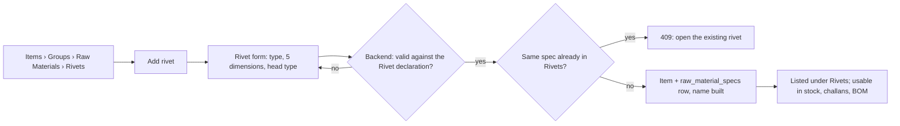

# 13 · Raw material forms: Rivets and Springs

Plan, checklist, flow and bug log for giving each default raw-material
subgroup its own entry form. Edited with every change.

## Where it stands

| Step | State |
|---|---|
| Default groups Raw Materials › Rivets, Springs | **Done** (2026-11-25): `groups.system_key`, seeded on boot, Clear Data and Factory Reset; delete, archive, rename and move refused (409); greyed out in the app with the reason |
| Rivet form, fields and name | **Built** (2026-11-25): Add rivet on the Rivets group window opens the form with the drawing; name built live; F/R head; rivet code; vendor prices |
| Spring form | **Built** (2026-11-25) from the owner's drawing: Wire Gauge, Wire Grade, Coil OD, Coil ID, Coil Length, Coil Number, Coil Hook; name `Double Hook Spring 114 X 6`; same engine as Rivets |

## As built (2026-11-25)

| Piece | Where |
|---|---|
| API `GET/POST /api/raw-materials/rivets`, `GET/PUT …/:id` | `backend/modules/items/rivets.js`, operations `items.rivets.*`, gated as `items` |
| Spec store | `raw_material_specs` (item_id, form_key, spec_key unique, code unique when given, values_json) |
| Vendor prices | `item_vendor_prices` (item_id, vendor_id, price_micro_rupees, basis piece/hundred/thousand/kg); any item can use it |
| Form | core_erp `raw_materials/presentation/rivet_form_dialog.dart` + `rivet_drawing.dart` (schematic, the typed field lights up) |
| Entry | Rivets group window: **Add rivet** in the footer, rivets listed above the items (tap = edit) |
| Item editor rail | Every Add Item / Edit opens with **Item · Rivet · Spring** down the left (`item_kind_switcher.dart`). A rivet opens on Rivet; any other item has Rivet drawn disabled; Spring disabled until built. Both views stay mounted, so switching keeps what was typed. An item filed under Rivets without a spec gets one on itself (PUT attaches) |
| Tests | backend `rivets-api.test.js` (3), app `rivet_form_test.dart` (6) |

Owner's decisions on the way: **F = Flat, R = Round**; each rivet has a **code**
(the shop's own, unique, optional); **vendors are attached with the price they
quote**.

Built as the plan below, except: the fields are declared in `rivets.js`, not
yet served to the app as data (`GET /api/raw-forms/:formKey`). That waits for
Springs, when there is a second form to share it.

## What the owner asked for

> Items → Groups → Raw Materials → Rivet, and after Rivet they will have this.

The same idea as the raw sheet's Width · Length · Thickness: a rivet is
described by a fixed set of dimensions, and the item's name is built from them.

### The Rivet drawing (from the owner)

```
            Head Diameter
                 ↓
   Silver   ┌─────────┐
   Layer →  ╱▔▔▔▔▔▔▔▔▔▔▔╲  ← Head OD
           ▔▔▔▔┃   ┃▔▔▔▔
               ┃   ┃  ← Shank Length
               ┃   ┃
               ┗━━━┛
           Shank Diameter
```

Worked example from the drawing:

| Field | Value |
|---|---|
| Rivet Type | Bimetal |
| Head OD | 3.5 |
| Head Diameter | 1.3 |
| Shank Diameter | 2.0 |
| Shank Length | 2.0 |
| Silver Layer | 0.25 |
| Head Type | Flat |

**Item name:** `Bimetal Rivet 3.5 X 1.3 / 2.0 X 2.0 Flat (0.25)`

## The Rivet form

### Fields

| # | Field | Kind | Stored as | Required |
|---|---|---|---|---|
| 1 | Rivet Type | list (Bimetal, …) | text | yes |
| 2 | Head OD | length, mm | integer nm + typed unit | yes |
| 3 | Head Diameter | length, mm | integer nm + typed unit | yes |
| 4 | Shank Diameter | length, mm | integer nm + typed unit | yes |
| 5 | Shank Length | length, mm | integer nm + typed unit | yes |
| 6 | Silver Layer | length, mm | integer nm + typed unit | see Q3 |
| 7 | Head Type | list (Flat, …) | text | yes |

Lengths follow the raw sheet (`RawStockForm`) and the units contract: integer
nanometres, with the unit they were typed in kept beside them so 2.0 shows as
2.0 mm again, not 2000000 nm. No floats are stored.

### The name is built, not typed

```
{Rivet Type} Rivet {Head OD} X {Head Diameter} / {Shank Diameter} X {Shank Length} {Head Type} ({Silver Layer})
```

- Built by the **backend** on save, so every client names a rivet the same
  way. The form shows a live preview, built by the same rule.
- Numbers are printed as typed: `2.0` stays `2.0` (it does not become `2`).
- With no silver layer, the `(…)` part is left off.

### Identity: one spec, one item

Every dimension is in the name, so two rivets with the same spec are the same
item. The backend refuses a second one in Rivets (409, naming the existing
item) instead of making a twin. This is the same rule as "same name + any
differing property = a separate part".

### Where the values live

One generic store for every raw-material form, not a table per kind:

```
raw_material_specs
  item_id     INTEGER PRIMARY KEY  → items(id) ON DELETE CASCADE
  form_key    TEXT    NOT NULL     -- 'raw_materials.rivets' | 'raw_materials.springs'
  values_json TEXT    NOT NULL     -- { rivetType, headOdNm, headOdUnit, … }
  created_at, updated_at
```

- The **fields of each form are declared once in the backend**, next to
  `SYSTEM_GROUPS` in `modules/items/system-groups.js` (key, label, kind,
  options, required). The backend validates against that declaration, and
  the app draws the form from it (`GET /api/raw-forms/:formKey`). Adding
  Springs means adding a declaration, not a table or a screen.
- The rivet is still an ordinary **item** in the Rivets group, so stock,
  purchase challans, BOM lines and orders work with no changes.
- Created in base `CREATE TABLE` plus `ensureColumnExists`, with no migration
  file, per the pre-release rule.

### In the app

- Items → Groups → Raw Materials → **Rivets**: the group's **Add** opens the
  Rivet form instead of the general item editor (keyed on
  `group.systemKey == 'raw_materials.rivets'`, never on the name).
- Layout: the fields on the left; the rivet drawing on the right, with the
  dimension being typed highlighted (the same idea as `band_form_animation`
  for the raw sheet); the built name under it, large.
- Keyboard: Tab through the 7 fields, then Save (the SheetStep flow). Lists
  open on Tab and can be typed into.
- Fonts: 14 px or larger for body text, 13 px or larger for pills. The name is
  large.
- An existing rivet opens back into the same form. Changing a dimension changes
  the name, so it asks first: **change this rivet**, or **make a new one**
  (the same guard the sheet uses).

### Flow



## Open questions for the owner

1. **"Head Diameter" = 1.3, but the shank is 2.0.** On the drawing the top
   face of the head is wider than the shank, yet 1.3 is smaller than 2.0.
   Is 1.3 really the head's **height (thickness)**? If so, we label it
   *Head Height*. The name format stays the same.
2. ~~The lists.~~ Answered: Head Type is F (Flat) or R (Round); Rivet Type is
   **Bimetal, Copper or Aluminium** and nothing else (a three-way choice in the
   form, enforced by the backend; "Aluminum" is taken as Aluminium).
3. ~~Silver Layer.~~ Decided with the types: only **Bimetal** has one, and
   there it is required; on Copper and Aluminium it is drawn disabled, blank,
   and left out of the name (backend refuses one). Was: **Silver Layer.** Is it only for Bimetal or Trimetal (blank and left out of
   the name for a plain Copper rivet), or always required?
4. **How rivets are bought and used.** The Rivets group counts in **Pieces**;
   a vendor's price can be per piece, 100, 1000 or kg. To turn a kg price
   into a piece cost, each rivet needs a pieces-per-kg figure: still open.

And for Springs: **the drawing**, the same kind of sheet as the rivet one.

## Springs — kinds, types, naming format (2026-11-25, second pass)

Owner's answers: the amp ratings are TYPES; wire gauge is a differentiator
the user may put in the name; a naming format with space / X / + / -;
kinds Double Hook, Conical (picture: Small OD, Large OD, Wire Diameter, Free
Length, Total Coils), Iron Connector (no picture — Double Hook's sizes, drawn
with plain legs).

- Identity (spec_key) = everything measured: kind, type, every size, gauge,
  grade. Two springs may not share a NAME (`uniqueNames` on the engine →
  409 `name_taken`, "add the block that differs — Wire Gauge, say").
- `nameFormat` = [{block, sep}] stored on each spring; blocks per kind
  (`blocksFor`), seps ' ' x + -. Default `{Kind} Spring {Length} X {Coils}`.
- Spring Type typed, offered: 1.5 Cell (the name is a guess from voice), 5 A
  Steel, 15 A Steel, 16 A Iron Connector; stored Title Case.
- App: `naming_format_editor.dart` (blocks ← → ×, separator picker, + to add,
  Reset), SpringDrawing(kind:) with a conical painter.
- Old springs stored `coilHook`: read as the kind.

## Springs — as built (2026-11-25, first pass)

- Backend: `modules/items/springs.js` is a declaration on the shared engine
  `modules/items/raw-forms.js` (rivets.js is the other). Routes
  `/api/raw-materials/springs`, operations `items.springs.*`.
- Name = `{Coil Hook} Spring {Coil Length} X {Coil Number}`; those three ARE
  the spring (409 on a twin, whatever the wire). Gauge (verbatim), grade, OD,
  ID are recorded, optional; ID must be under OD. Hook is typed, Double Hook
  one tap, stored Title Case.
- App: `spring_form_dialog.dart` + `spring_drawing.dart` (side view + an end
  view for OD/ID/wire), Springs group window has Add spring + list, the item
  editor rail's Spring is live. Vendor price rows shared with rivets
  (`vendor_prices_editor.dart`).
- Open: the spring TYPES heard earlier (5 A / 15 A steel, 16 A iron connector,
  "1.5 cell") are not on the form; if gauge should be in the name, two springs
  differing only in wire would stop sharing one.

## Springs — what the owner said before the drawing (superseded)

Heard over voice, so the type names may be mis-transcribed:

| # | Spring type (as heard) | Code? |
|---|---|---|
| 1 | "1.5 cell spring" (?) | ? |
| 2 | 5 Amp steel spring | ? |
| 3 | 15 Amp steel spring | ? |
| 4 | 16 Amp iron connector | ? |

"These two have codes as well" — which two is not yet clear.

Example name: **`114 x 6 (II) Double hook spring`**. Which number is which
dimension (114, 6), what (II) means, and what other end types exist besides
Double hook are open. A drawing like the rivet one would settle the fields.

## Checklist (design philosophy §6)

- [x] Data shape vs view: a new canonical shape (a spec per item). The groups
      are data, the form is a view of the declaration.
- [x] Rules in the backend: name building, required fields, list values,
      spec uniqueness and system-group guards all live in the backend.
- [ ] Event: `item.created` / `item.updated` through the existing Track
      (`req.track`). No new floor event.
- [ ] Metric: feeds the inventory cluster (raw material on hand by spec).
- [x] Multi-client: forms keyed by `system_key` and declared as data, with
      no hard-coded per-client branch.
- [x] Quantities: integer nm plus typed unit (units skill). Count in Pieces.

## Bug log

| # | Found | State |
|---|---|---|
| R1 | Seed made "Raw Materials"; the guards checked "Raw material", so nothing recognised it, and any edit of Raw Materials filed it under Primary Group | Fixed with `system_key` (2026-11-25) |
| R2 | `isPrimaryGroupNameForType` in `server.js` is defined and never called, so the default groups had no delete protection | Superseded by the `system_key` guards. The dead function remains |
| R4 | The item form can still rename a rivet; the next rivet save rebuilds the name from the spec | Open, low |
| R3 | `saveGroup` throws "unitId is required" without a status code, so it answers 500, not 400 | Open, not touched |
